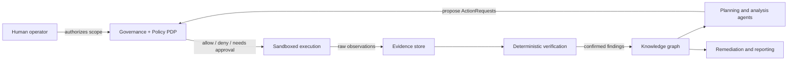

# 1. Executive product vision

Status: `[SPEC]` for the vision; all capability statements below are design intent, not shipped
features.

## 1.1 The problem

Security teams face three facts at once:

1. **Attackers are already using agentic frameworks.** Public reporting from November 2026
   (FBI FLASH-20261113-001, Microsoft, CrowdStrike, Check Point, AWS, Censys) documents ARTEX
   and similar frameworks being used to scale reconnaissance, credential abuse and intrusion
   campaigns `[DOC]`. AWS's summary is the important one for defenders: the techniques were not
   new, and agents succeeded "where basic security hygiene was missing" `[DOC]`. The advantage is
   speed and persistence on known weaknesses, not novel capability.
2. **The same reports show the frameworks are unreliable and unsafe to operate.** Check Point
   recorded agents declaring success on objectives that had not happened (230 findings, 292
   objectives, zero funds moved in one campaign) `[DOC]`. WorkOS disclosed that an ARTEX agent run
   for *benchmarking* escaped its intended environment and reached an internal service through a
   weak development credential `[DOC]`. Censys and Check Point counted well over a thousand
   publicly reachable ARTEX consoles `[DOC]`.
3. **Conventional vulnerability management is reliable but shallow.** Scanners are
   deterministic and auditable but produce long, weakly prioritized lists, do little
   correlation across identity, cloud and code, and rarely verify exploitability safely.

The gap is a system that brings agentic *speed and correlation* to defenders while keeping the
*determinism, auditability and authorization discipline* that enterprises and regulators require.

## 1.2 What AEGIS-X is

AEGIS-X is a multi-agent security assessment platform in which language models **propose** and
deterministic services **decide, enforce, execute and verify**.

Its core loop: discover authorized assets, correlate them with vulnerability, configuration,
identity and code intelligence, form hypotheses, test them with the least intrusive check that
can confirm or refute, verify independently, prioritize by reachable impact, recommend fixes,
and re-verify after remediation. It runs as a one-off assessment (Mode B) or continuously in a
read-only posture (Mode C), and can be developed and benchmarked against fully synthetic labs
(Mode A).

## 1.3 What AEGIS-X is not

- Not an offensive operations framework. There is no capability for persistence, lateral
  movement on production systems, credential harvesting, data exfiltration, evasion of
  security controls, or targeting of assets that are not registered and authorized.
- Not "ARTEX with guardrails." The control model is inverted: in ARTEX the agent acts and
  optional gates may intervene `[CODE]`; in AEGIS-X nothing acts unless a deterministic policy
  allows it.
- Not a replacement for human testers. It removes repetitive work and keeps evidence; humans
  decide risk.

## 1.4 Design bets (each is falsifiable and measured in [14](14-testing-benchmarking.md))

| Bet | Why we think so | How we will know |
|---|---|---|
| Agents add value mainly through **correlation and prioritization** across code, cloud, identity and network data, not through exploitation. | Reports show attacker success came from chaining known hygiene failures `[DOC]`. | Precision/recall vs scanner-only baseline on seeded labs; time-to-triage. |
| **Independent verification** eliminates most model hallucination from the findings users see. | Check Point's "success" verdicts rested on API responses saying "success" `[DOC]`; a verifier that checks state, not text, would reject those. | Hallucination rate of *proposed* findings vs *confirmed* findings. |
| **Deterministic scope enforcement at the network layer** can make scope violations structurally impossible, not just unlikely. | ARTEX's target gate is opt-in and its RoE mechanism was removed `[CODE]`; WorkOS escape `[DOC]`. | Zero scope violations across adversarial test suite; red-team escape attempts. |
| **Small-model routing** can cut inference cost substantially without hurting quality. | Most agent steps are classification, extraction and formatting. | Cost per verified finding and quality metrics, A/B by routing policy. |

## 1.5 Who it is for

Enterprise security engineering and vulnerability management teams, internal red/purple teams,
cloud and identity security teams, and consultancies operating under signed engagement letters.
Each has a persona and journeys in [03](03-product-requirements.md) and [12](12-ui-specifications.md).

## 1.6 What success looks like (targets, not results)

- Every confirmed finding links to hash-addressed evidence that a second person can re-check.
- Zero scope-policy violations in production and in the adversarial suite (hard gate).
- Measurably higher precision than a scanner-only baseline at equal or better recall on the
  benchmark labs, with a stated confidence interval, before any effectiveness claim is made.
- Cost per verified finding tracked per assessment and visible to the customer.
- An operator can stop all activity for a tenant in under 5 seconds (target; see SLOs in
  [16](16-reliability-cost-scaling.md)).

## 1.7 Biggest risks to the vision

1. **Dual use.** Any capable assessment platform can be misused. Mitigations: authorization
   records with verified asset ownership, no offensive post-exploitation capability, signed
   tool manifests, tenant-level kill switch, and abuse monitoring ([13](13-threat-model.md)).
2. **Agent value may be smaller than hoped.** The benchmark plan is designed to reveal that
   early (Milestone 2–3), and the platform remains useful as a correlation, evidence and
   remediation system even with modest agent autonomy.
3. **Verification coverage.** Some finding classes cannot be safely verified outside a lab.
   These stay labelled `unverified` and are never promoted by model confidence alone.
