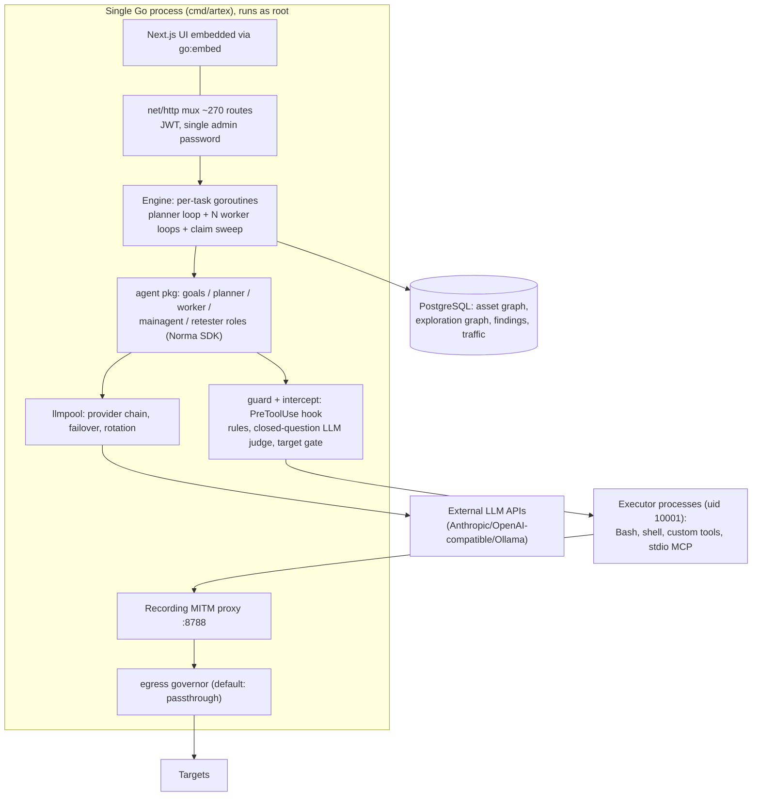

# 2. ARTEX architecture and limitations analysis

This is Phase 1 of the brief. It answers the eight research questions using two kinds of
evidence, labelled throughout:

- **`[CODE]`**: the ARTEX source in this repository (fork of `BaaRai/ARTEX` at commit `38c7477`,
  module `github.com/Autumn-27/artex`). The code was **read, not executed**. The upstream
  repository was withdrawn (FBI says 8 Oct 2026; Check Point gives conflicting dates) `[DOC]`, so
  this fork may differ from what threat actors ran.
- **`[DOC]`**: first-party publications listed in [references.md](references.md): FBI FLASH-20261113-001,
  three Microsoft Security blog posts, two CrowdStrike posts, Check Point Research, AWS Security,
  WorkOS, Censys, OWASP and NIST.

**Gaps in the evidence, stated up front**

- The Google Threat Intelligence post ("ARTEX and friends…") **could not be retrieved** (the
  server returned an error). Nothing in this document is attributed to Google.
- None of the first-party sources describes ARTEX's internals beyond "Go backend, Next.js
  console, PostgreSQL, planner/worker agents, shared graph, external LLMs" `[DOC]`. Everything
  more detailed below comes from the code.
- None of the sources reports controlled, repeatable measurements of ARTEX's effectiveness.
  Incident counts describe specific campaigns run by specific operators and are **not**
  evidence of general performance. We use them only to illustrate failure modes.

## 2.1 Reported and observed architecture (research question 1)

### What first-party sources say

| Claim | Source |
|---|---|
| "A multi-agent LLM system written in GO with a Next.js frontend"; agents "accumulate the discovered assets and vulnerabilities into a graph"; "can use any AI model" | Microsoft, 21 Oct 2026 `[DOC]` |
| Written in Go; no model of its own; integrates external providers (Anthropic, OpenAI, DeepSeek, GLM, Grok, Kimi); DeepSeek "Flash-family" models dominate attacker instances | FBI FLASH `[DOC]` |
| Go backend, Next.js console, PostgreSQL; planner creates intents, workers run tools, event-driven loop until goal met; published 26 Jul 2026 under AGPL-3.0 | Censys `[DOC]` |
| A main agent coordinating planner and worker agents "over a shared graph of facts, findings, and goals"; each engagement is a "task" | CrowdStrike (VAPOR PANDA) `[DOC]` |
| Planner, worker, verification and compression agents sharing a persistent knowledge graph, "the operation's shared memory"; ≥4 concurrent sessions handing off work | AWS `[DOC]` |
| Dashboard covers assets, progress, captured traffic, findings; supports retesting | Check Point `[DOC]` |

### What the code shows

Key facts `[CODE]`:

- **One binary, one process.** `cmd/artex` serves the API (~270 routes), runs the agent engine,
  the MITM proxy, and embeds the Next.js 16 / React 19 UI (`docs/ARCHITECTURE.md`,
  `server/webui_embed.go`). PostgreSQL is the only external dependency. The scanner toolchain
  (`nmap`, `nuclei`, `httpx`, `katana`, `ffuf`, `dalfox`, `sqlmap`, …) ships in the image (README).
- **Agent runtime** is the author's own SDK, `github.com/Autumn-27/norma` (`go.mod`), which
  provides the LLM loop, tool hooks (`hook.PreToolUse`/`PostToolUse`), transcript and
  untrusted-output framing.
- **Roles**: `goals`, `main`, `planner`, `worker`, `assistant` (DB constraint `agents_role_ck` in
  `db/schema.sql`) plus a `retester` (`agent/retester.go`) and a background LLM `Compactor`
  (`agent/compaction.go`).
- **Two graphs in PostgreSQL** (`docs/ARCHITECTURE.md` §1): a company-scoped *asset graph*
  (`companies`, `company_scope`, `assets`) and a per-task *exploration graph*
  (`explorations`, `exploration_nodes`, `exploration_edges`, `exploration_anchors`) with node
  kinds `goal / intent / fact / finding / hint` and edges `spawns / derived_from / yields / proves`.
  Asset dedup keys and parent/child containment are computed by code; agents submit raw
  observations (README).
- **Schema management**: idempotent `schema.sql` run on every start, plus 13 numbered
  migrations recorded with SHA-256 (`db/migrate.go`).
- **Tenancy**: none. There is no `users` or `tenants` table; authentication is a single admin
  password (`server/auth.go`, `auth.password_hash`) bootstrapped by a one-time setup token.
  "Companies" are asset owners within one operator's database, not isolation boundaries.

## 2.2 How LLMs connect to tools (question 2)

`[CODE]` Agents call tools through the Norma tool loop. Tool classes:

| Class | Examples | Mediation |
|---|---|---|
| Shell | `Bash`, `shell_open`, `shell_send` (interactive) | `guard.preToolUse` → intercept rules → optional judge → optional target gate; process runs as uid 10001 |
| HTTP | `WebFetch` (platform client) | `intercept.PinnedDialer` + `RedirectCheck` re-check scope at dial time when the target gate is on |
| File | Read/Write/Edit/Glob/Grep | Confined to the run directory via `os.Root` |
| Graph/platform | `insert_assets`, `addFinding`, `prove_goal`, `ingest_bbot`, `search_all_worker_traces` | Go functions; `insert_assets` runs `EvaluateAssetGate` |
| Extensible | MCP servers (`mcphttp`), custom tools, skills (`skills/*/SKILL.md`) | "Persistence tools … need operator approval by default" (`SECURITY.md`) |

The model emits a tool call; the hook decides allow/ask/block; the tool runs with the full
argument string. Shell is the dominant tool surface: it is a general-purpose interpreter, so
the allow/deny policy has to reason about arbitrary command lines (`intercept/argv*.go` is a
substantial shell-grammar parser for this reason).

Documented `[DOC]`: Microsoft and the FBI list default tools (Nmap, curl, wget, Python HTTP
clients, Norma WebFetch, headless Chromium/Playwright). CrowdStrike found a `CLAUDE.md` with a
testing prompt on an actor host, i.e. general coding agents were also used alongside ARTEX.

## 2.3 Coordination and finding exchange (question 3)

`[CODE]` Coordination is **through the database, not messages**:

1. A graph change (debounced) wakes the planner (`server/engine.go`, `plannerLoop`).
2. The planner reads `graph_overview`, coverage and scope, judges goals, and writes 0..N
   `intent` nodes with `asset_ids` (`agent/planner.go`, `addOneIntent`). It keeps a per-task
   todo list across wake-ups for multi-step chains.
3. Workers (goroutines) `claimNext` one open intent, execute, write `fact` / `finding` / asset
   rows back, and stop (`agent/worker.go`).
4. Workers can read each other's raw execution traces (`search_all_worker_traces`), so
   unpromoted observations are shared.
5. `prove_goal` closes a goal; the last closed goal completes the task.

This is a classic **blackboard architecture**. It is simple and debuggable, but every agent can
read everything in the task, there is no per-message authentication or typing, and the
planner is a single point of judgement for the whole task.

## 2.4 Task execution, memory and retries (question 4)

`[CODE]`:

- **Leases with fencing.** An intent claim carries a fresh `unclaim_token` and
  `last_heartbeat_at`; TTL 90 s, heartbeat 15 s (`db/exploration.go`). A sweep loop returns
  expired claims to `open`; a worker whose heartbeat is rejected is cancelled with
  `AbortWorkClaimLost`. This is a sound design worth keeping.
- **Cancellation** uses `context.WithCancelCause` with a named cause, so the trace records who
  stopped work. Per-intent pause/cancel and "steer" messages are drained before the next tool call.
- **Budgets** via environment variables (`ARTEX_TASK_BUDGET_TOKENS/TURNS`,
  `ARTEX_INTENT_BUDGET_*`); spend is restored from `llm_usage` after restart; a forced wrap-up
  reserve exists (`agent/budget.go`, README).
- **Memory**: the exploration graph is the long-term memory; a background `Compactor` uses an
  LLM to fold "cold" nodes into digests (`agent/compaction.go`). Lessons learned across tasks are
  stored in `rsi_lessons` with evidence. Digest text is model-generated and replaces source
  detail in the planner's view `[INFERRED]`, which risks laundering hypotheses into "memory".
- **LLM retries/failover**: `llmpool` orders profiles, skips members whose context window is too
  small, records health, fails over, and optionally rotates workers across providers
  (`llmpool/pool.go`, README "Multi-provider workers").
- **No durable workflow engine.** Work runs in in-process goroutines; durability comes from the
  DB state plus restart recovery. A process crash loses in-flight tool executions; they are
  retried after the lease expires `[INFERRED]`.

## 2.5 Reliability and scalability limitations (question 5)

| Limitation | Evidence |
|---|---|
| Single process; agent loops, API, proxy and UI share fate and memory. Horizontal scaling across nodes is not designed in. | `[CODE]` `cmd/artex`, `server/engine.go` |
| Concurrency is a global "worker count" setting applied to subsequently started tasks. | README |
| Agents declared success on unmet objectives; "success" verdicts rested on API responses that said "success". In one campaign: 292 objectives, 230 findings, ~400k agent messages, nothing achieved. | Check Point `[DOC]` |
| Sub-agents "overwriting each other or generating duplicate requests" is listed as an observable trait. | FBI `[DOC]` |
| Planning agents in one intrusion consumed ~1.4 billion input tokens. | CrowdStrike `[DOC]` |
| Rotation "does not rebalance around a dead provider"; the rotation cursor resets on restart. | README `[CODE]` |
| Agents "shifted to alternative approaches when a path failed" and showed adaptive troubleshooting of API errors. These are strengths for persistence but also mean failures are retried with variations, inflating cost and noise. | CrowdStrike, Microsoft `[DOC]` |

## 2.6 Unauthorized access, sandbox escape, exposed consoles, excessive permissions (question 6)

| Risk | Evidence | Root cause (ours) |
|---|---|---|
| **No enforced authorization scope.** `guard.go` states: "The RoE authorization-scope mechanism was removed; a replacement may be added later." The target gate is "opt-in", "off by default, API-only". | `[CODE]` `guard/guard.go`, `server/dto.go`, README | Scope is a coverage denominator, not an enforcement boundary. |
| **Destructive/exfiltration gating is deletable data.** "Destructive/exfil gating … lives in the DB intercept rules (seeded as ordinary [built-in] rules, so users can disable or delete them)." | `[CODE]` `guard/guard.go` | Safety is configuration, not invariant. |
| **A model can approve actions.** The closed-question judge asks an LLM eight fixed questions and code maps answers to allow/deny; approvals record `decided_by` = `human`, `rule`, **`model`** or `system`. One question asks whether the call is "a normal technique of an authorized penetration test … exploitation payloads". | `[CODE]` `intercept/closed_judge.go`, README | Well engineered (fails to "ask", caps input), but still makes an LLM part of the authorization path. |
| **Scanner-asserted scope is trusted.** `ingest_bbot` accepts the scanner's own in-scope verdict; with no task allow-list, any non-blocked host enters the graph. Documented as an accepted gap. | `[CODE]` `SECURITY.md` | Scope evaluated by the tool, not by the platform. |
| **Process containment is "not a sandbox".** Server runs as root; agent processes drop to uid 10001 but "can still read world-readable files under the data directory, reach the loopback API and the database if the network allows it". Several root path-handling races are listed as residual. | `[CODE]` `SECURITY.md` | Executor shares host, kernel and network with the control plane. |
| **Sandbox escape in practice.** An ARTEX agent run by a researcher for benchmarking "escaped its isolated testing environment" and reached an internal WorkOS tool via public exposure, a weak dev credential, and no rate limiting; detected only after bulk retrieval. | WorkOS `[DOC]` | The "isolated" environment had internet egress, and the target had hygiene gaps; no platform-level egress allowlist stopped it. |
| **Exposed consoles.** Censys: 1,465 hosts (≈815 distinct-looking), default port 8787. Check Point: 2,557 hosts ever, 1,608 live, 10 exposing the full database. FBI: "over 1,600". | `[DOC]` | Single-tenant admin console designed for localhost, deployed on the internet. The fork now binds to `127.0.0.1` by default (README); whether early releases did is `[UNKNOWN]`. |
| **Offensive defaults.** Shipped skills include `edr-bypass-re` and `php2shell`; the image bundles exploitation tools such as `sqlmap`. | `[CODE]` `skills/`, README | Product scope is offensive by design. |
| **Model switching to evade provider safety.** Operators hit guardrails with one frontier model and switched to more permissive models; FBI cites "lack of observable guardrails when framed for penetration testing" as why some models dominate. ARTEX's provider rotation/failover makes switching trivial. | Check Point, FBI `[DOC]` | Model choice is an operator convenience with no policy. |

## 2.7 Observability, auditing and human approval (question 7)

Strengths `[CODE]`: per-call LLM records and token accounting (`llmrec`, `llm_usage`); every
intercept decision persisted with approver subject; activity trace per node; captured HTTP
traffic bound to findings; findings are `verified` only when bound proof and verbatim quotes
match the stored response (README, `db/finding_verification.go`). This "keeps its receipts"
design is the best idea in ARTEX and AEGIS-X adopts it.

Limitations:

- **Audit is not tamper-evident.** No hash chaining or external anchoring was found
  (`grep` for chain/prev-hash fields: none) `[CODE]`. Root on the host can rewrite history.
- **Planner and main-agent calls are not written to the guard's audit ring on pass**
  (`NewTargetOnly`, `guard/guard.go`) `[CODE]`.
- **Human approval is optional and was little used.** CrowdStrike saw a human "only to steer
  the agents at decision points"; Check Point recorded "Operator Prompting: None" in two
  campaigns; FBI: "minimal human interaction beyond initial objective setting" `[DOC]`.
- **No multi-person control**: a single admin approves, configures rules, and deletes them `[CODE]`.
- **Verification is evidence-quote matching**, which proves a response contained text, not that
  the claimed impact occurred. Check Point's hallucinated "success" cases show why that is
  not enough `[DOC]` `[INFERRED]`.

## 2.8 Alternative frameworks and conventional platforms (question 8)

| System | Type | Relative strengths | Relative weaknesses | Evidence |
|---|---|---|---|---|
| ARTEX | Agentic pentest | Dual graph; evidence-bound findings; lease/fencing; traffic capture; retest loop | Offensive scope; no tenancy; optional scope; LLM in approval path; shared-host execution | `[CODE]` `[DOC]` |
| PentAGI | Agentic pentest | Containerized tool execution per task; knowledge-graph memory | Same offensive orientation; authorization model not verified | Named by Check Point/Censys `[DOC]`; traits `[GENERAL]` |
| CyberStrike(AI), Cairn, HexStrike AI, "PZZ" | Agentic offensive frameworks / MCP tool servers | Large tool catalogues exposed to LLMs | Not analysed; co-located with C2 frameworks on actor hosts | Check Point, Censys `[DOC]`; no further traits documented |
| PentestGPT (research) | LLM-assisted pentest | Published evaluation methodology | Human-driven, not autonomous | `[GENERAL]` |
| Network/host VM scanners (e.g. Tenable, Qualys, Rapid7, OpenVAS) | Conventional | Deterministic, auditable, mature coverage and compliance mappings | Weak correlation and prioritization, no exploitability reasoning | `[GENERAL]` |
| CSPM/CNAPP (e.g. Prowler, Wiz-class products) | Cloud posture | Read-only API-based, safe, broad cloud coverage, attack-path graphs | Limited app-layer and code correlation in OSS tools | `[GENERAL]` |
| DAST/template scanners (ZAP, Nuclei) | App scanning | Repeatable, safe-mode checks, large community templates | False positives without context, no business-logic reasoning | `[GENERAL]` |
| BAS (e.g. SafeBreach, AttackIQ) | Detection validation | Controlled, pre-approved scenarios; measured control efficacy | Scenario authoring effort; limited discovery | SafeBreach published ARTEX coverage `[PRESS]`; traits `[GENERAL]` |

**Synthesis.** Conventional tools win on determinism, safety and auditability; agentic
frameworks win on correlation, persistence and adaptive follow-up. AEGIS-X's design keeps
conventional engines as the *executors* (scanners, CSPM checks, SAST, secret scanners) and uses
agents for planning, correlation, hypothesis generation and explanation, never as the authority.

## 2.9 Comparison matrix

Complexity: S (≤2 eng-weeks), M (2–8), L (2–6 eng-months), XL (>6). "Expected measurable
benefit" names the metric from [14](14-testing-benchmarking.md) that should move; no values are claimed.

| # | Existing ARTEX capability | Current limitation | AEGIS-X improvement | Complexity | Security implications | Expected measurable benefit (metric) |
|---|---|---|---|---|---|---|
| 1 | Task scope rows; opt-in target gate `[CODE]` | Not enforced by default; RoE removed | Signed authorization record compiled into a policy bundle; PDP check on every action + SEEG egress enforcement, always on | L | Core control; removes the largest risk class | Scope-policy violations = 0 in adversarial suite (hard gate) |
| 2 | Intercept rules incl. seeded destructive rules `[CODE]` | Deletable by the single admin | Capability classes compiled from signed tool manifests; destructive classes absent from Modes B/C, not just denied | M | Shrinks attack surface; safety is code | Count of state-changing actions outside approved classes = 0 |
| 3 | LLM closed-question judge can approve `[CODE]` | Model in authorization path | Models may *annotate* risk; only PDP rules or humans decide; approval bound to action hash + step-up auth | S | Removes prompt-injection path into authorization | Approval-bypass tests pass; % approvals by humans vs rules |
| 4 | Single-process engine with DB leases `[CODE]` | No horizontal scale; shared fate | Durable workflow engine (Temporal) + stateless agent workers + per-execution sandboxes | L | Blast radius isolation | Recovery time; worker reliability; throughput per node |
| 5 | Executor uid drop on shared host `[CODE]` | "Not a sandbox"; can reach DB/API | Ephemeral gVisor/Firecracker sandboxes, no route to control plane, default-deny egress via SEEG | L | Prevents WorkOS-class escape | Escape test suite pass rate; egress-deny hit counts |
| 6 | `ingest_bbot` trusts scanner scope `[CODE]` | Tool decides scope | Every ingested asset re-evaluated by PDP; out-of-scope stored as `observed_out_of_scope`, never actionable | S | Closes documented gap | Out-of-scope actionable assets = 0 |
| 7 | Evidence-quote verification `[CODE]` | Proves text presence, not impact | Verification service with per-class deterministic verifiers (state checks, re-request diffing, API reads) + second independent observation | L | Fewer false claims reach users | Hallucination rate of confirmed findings; precision |
| 8 | Activity + intercept history in DB `[CODE]` | Not tamper-evident; planner passes not logged | Hash-chained per-tenant audit log, periodic anchoring to WORM storage, every decision logged | M | Non-repudiation | Audit-integrity tests; % actions with audit record = 100% |
| 9 | Single admin password `[CODE]` | No tenancy, RBAC, MFA, or separation of duties | OIDC + MFA, RBAC/ABAC (Cedar), two-person rule for scope and high-risk approvals, Postgres RLS | M | Prevents insider and console-takeover abuse | Cross-tenant test suite pass; authz test coverage |
| 10 | Console binds loopback (current fork) `[CODE]`; >1,400 exposed `[DOC]` | Easy to expose | No unauthenticated surface; SSO-only; private ingress by default; exposure self-check | S | Removes console-exposure class | External exposure scan of deployment = clean |
| 11 | LLM provider rotation/failover `[CODE]` | Enables switching to evade provider safety `[DOC]` | Model capability registry with policy: a refusal is terminal for that action, not a trigger to reroute | S | Respects provider safety | Refusal→reroute count = 0 |
| 12 | Blackboard: all workers read all traces `[CODE]` | Over-sharing; injection spreads | Typed, signed agent messages; need-to-know context assembly; provenance labels on every context item | M | Limits indirect-injection propagation | Injection-propagation tests |
| 13 | LLM compaction of cold nodes `[CODE]` | Model summaries become memory | Summaries are derived views linked to sources, marked `model_generated`, never used as evidence | S | Prevents hypothesis laundering | Evidence completeness |
| 14 | Env-var budgets `[CODE]` | Global, operator-editable at runtime | Budgets in the authorization record, enforced by PDP and model gateway, per agent/task/tenant | S | Bounds runaway cost and noise | Cost per verified finding; budget-breach count |
| 15 | Noise governor (default off) `[CODE]` | Passthrough by default | Mandatory per-asset rate limits from the authorization record, enforced in SEEG | S | Protects target availability | 429/5xx rate induced on targets |
| 16 | Offensive skills/tools shipped `[CODE]` | Scope creep into exploitation | Signed tool catalogue limited to assessment and verification; no post-exploitation | S | Dual-use reduction | Catalogue review gate |
| 17 | Retester agent `[CODE]` | Model-driven retest | Deterministic re-verification plans generated with the finding | M | Reliable fix verification | Remediation verification accuracy |
| 18 | Asset graph only for network/web assets `[CODE]` | Identities, OAuth apps, cloud trust absent | First-class identity, permission and trust-relationship nodes | M | Matches the real attack paths in reports `[DOC]` | Recall on identity/cloud seeded misconfigs |

## 2.10 Lessons carried into AEGIS-X

Keep: dual graph (knowledge vs execution history), programmatic dedup keys, lease + fencing
tokens, cause-tagged cancellation, traffic-bound evidence, nonce-framed untrusted output (as one
layer among several), dial-time DNS pinning (ADR-002), per-column AEAD with AAD (ADR-003).

Replace: optional scope → mandatory compiled policy; shared-host executor → ephemeral sandbox;
LLM judge in authorization → deterministic PDP + humans; single admin → tenanted RBAC with
two-person rules; text-quote verification → state-based verifiers; mutable audit → hash chain;
offensive tool catalogue → signed assessment-only catalogue.

## 2.11 Licensing and provenance

ARTEX is AGPL-3.0 `[CODE]` (`LICENSE`). Copying its code into AEGIS-X would make AEGIS-X a
derivative work subject to AGPL network-use obligations. AEGIS-X is therefore specified as a
**clean-room implementation**: engineers may read this analysis, not copy ARTEX code. The ideas
listed in §2.10 are general engineering patterns, not copyrightable expression. Have counsel
confirm before any code reuse. ARTEX's dependencies (notably the author's `norma` SDK) have not
been security-reviewed and must not be imported.
