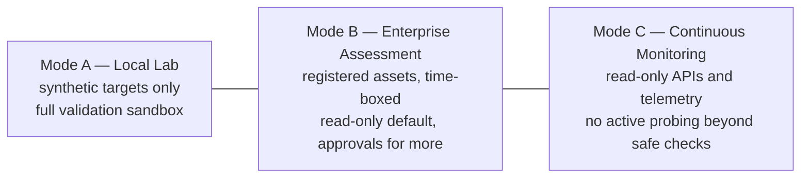

# 3. Product requirements document

Status: `[SPEC]`. Requirement IDs are stable and referenced by the backlog
([19](19-engineering-backlog.md)) and tests ([14](14-testing-benchmarking.md)).
Priority: **P0** = MVP, **P1** = GA, **P2** = later.

## 3.1 Personas

| Persona | Goal | Primary views |
|---|---|---|
| **Security Engineering Lead** (Maya) | Run quarterly assessments of registered assets, track remediation | Assessment Builder, Findings, Remediation |
| **Assessment Operator** (Dev) | Drive an active assessment, approve risky steps, triage findings | Agent Ops Center, Findings, Evidence Timeline |
| **Authorization Approver** (Legal/CISO delegate) | Sign scope and rules of engagement; second approver for high-risk actions | Governance Console |
| **Cloud/Identity Owner** (Sam) | Receive and fix findings on their systems | Remediation Center |
| **CISO / Executive** | Understand posture trends | Executive Dashboard, Reporting |
| **Platform Admin** | Manage tenants, SSO, model providers, tool catalogue | Governance Console |
| **Auditor** (internal/external) | Verify that testing was authorized and evidence is intact | Governance Console (read-only), Evidence Timeline |

## 3.2 Deployment modes

### 3.2.1 Capability-by-mode matrix

Legend: ✅ available, 🔐 available only with explicit authorization-record flag **and** per-action
human approval, ⛔ not available (code path not loaded in that mode).

| Capability class (see [10 §10.4](10-secure-execution.md)) | Mode A | Mode B | Mode C |
|---|---|---|---|
| `C0` Platform-internal reasoning, graph queries | ✅ | ✅ | ✅ |
| `C1` Passive discovery (DNS, CT logs, WHOIS of registered domains, cloud inventory APIs) | ✅ | ✅ | ✅ |
| `C2` Read-only authenticated API reads (cloud config, IdP, SCM, CMDB) | ✅ | ✅ | ✅ |
| `C3` Low-impact active network probing (TCP connect/service banner, TLS handshake, HTTP GET/HEAD of known paths) | ✅ | ✅ | 🔐 (scheduled safe checks only) |
| `C4` Non-destructive vulnerability checks (version-based, safe templates, benign reflection markers) | ✅ | ✅ (risk-scored) | ⛔ |
| `C5` Authenticated app testing with test accounts (read-only flows) | ✅ | 🔐 | ⛔ |
| `C6` Proof-of-control in isolated replica (exploit-class verification) | ✅ | 🔐 only against a customer-provided isolated replica registered as such | ⛔ |
| `C7` Detection validation: synthetic benign events in production telemetry pipelines | ✅ | 🔐 | 🔐 |
| `C8` State-changing actions on production (writes, config changes, account changes) | ✅ (lab) | ⛔ | ⛔ |
| `C9` Destructive, DoS, persistence, credential harvesting, exfiltration, evasion | ⛔ | ⛔ | ⛔ (no implementation exists) |

C9 is not a policy setting. There is no tool in the signed catalogue for it, and the catalogue
review gate ([17](17-implementation-roadmap.md)) rejects additions.

### 3.2.2 Permissions required per mode

| Mode | Platform roles needed to start | Customer-side credentials | Authorization record requirements |
|---|---|---|---|
| A | `lab_operator` | None (synthetic) | Lab environment ID; network is air-gapped from customer and internet except allowlisted package mirrors |
| B | `assessment_owner` creates; `authorization_approver` (different person) signs | Least-privilege read roles (e.g. AWS `SecurityAudit`+`ViewOnlyAccess`, Azure `Reader`+`Security Reader`, GCP `roles/iam.securityReviewer`+`roles/viewer`, Entra `Directory.Read.All`/`Policy.Read.All` as app permissions, SCM read-only app); test accounts for C5 | Asset ownership verified (DNS TXT, cloud account ID via role assumption, SCM org install); validity window ≤ 90 days; rate limits; contacts; capability ceiling; two signatures |
| C | `monitoring_owner` + `authorization_approver` | Read-only roles and telemetry read access only | Same as B, renewable ≤ 365 days, capability ceiling ≤ C3 |

Credential lists are starting points; the exact minimum permission sets per connector are a
deliverable of Milestone 2 (`[CONCEPT]`).

## 3.3 Functional requirements

### Authorization and scope (FR-AUTHZ)
- **FR-AUTHZ-1 (P0)** Create an authorization record with: tenant, assets/patterns, exclusions,
  capability ceiling, rate limits per asset class, time windows, validity, contacts, approvers.
- **FR-AUTHZ-2 (P0)** Require two distinct humans (creator ≠ approver) to activate; both with MFA.
- **FR-AUTHZ-3 (P0)** Records are immutable after activation; changes create a new version that
  needs re-approval. Running tasks continue under the old version only if the new one is a subset.
- **FR-AUTHZ-4 (P0)** Asset ownership verification before an asset can be in scope
  (DNS TXT token, cloud role assumption with external ID, SCM app installation).
- **FR-AUTHZ-5 (P0)** Compile records into a signed, versioned policy bundle consumed by the PDP and SEEG.
- **FR-AUTHZ-6 (P0)** Tenant kill switch and global kill switch.

### Assessment management (FR-ASMT)
- **FR-ASMT-1 (P0)** Create assessments from objectives + testing profile + budget + authorization record.
- **FR-ASMT-2 (P0)** Show a plan for review before execution; operator may edit or reject steps.
- **FR-ASMT-3 (P0)** Pause, resume, cancel at assessment, task, and action level.
- **FR-ASMT-4 (P1)** Schedules for recurring assessments (Mode C default).

### Discovery and inventory (FR-DISC)
- **FR-DISC-1 (P0)** Ingest assets from cloud inventory APIs, DNS, CT logs, SCM orgs, CMDB CSV.
- **FR-DISC-2 (P0)** Every discovered asset is evaluated by the PDP; out-of-scope assets are
  stored as `observed_out_of_scope`, shown to users, never acted on.
- **FR-DISC-3 (P1)** Continuous drift detection in Mode C (new/removed/changed assets).

### Analysis modules (FR-MOD) — detailed in section 3.6 and [10](10-secure-execution.md)
- **FR-MOD-WEB (P0)**, **FR-MOD-CLOUD (P0)**, **FR-MOD-CODE (P0)**, **FR-MOD-IDENTITY (P1)**,
  **FR-MOD-INFRA (P1)**, **FR-MOD-DETECT (P2)**.

### Findings and evidence (FR-FIND)
- **FR-FIND-1 (P0)** Findings have states `hypothesis → candidate → confirmed | refuted | unverifiable`,
  plus lifecycle `open → in_remediation → fixed_pending_verification → resolved | accepted_risk`.
- **FR-FIND-2 (P0)** A finding is `confirmed` only by the Verification service (INV-6).
- **FR-FIND-3 (P0)** Every finding links to evidence items with SHA-256 content hashes.
- **FR-FIND-4 (P0)** Dedup across assessments by deterministic fingerprint.
- **FR-FIND-5 (P0)** Secrets are never stored or shown in full: store HMAC fingerprint, type,
  location, first/last 4 chars max, and entropy class.
- **FR-FIND-6 (P1)** Risk score combining severity, exploitability evidence, exposure, asset
  criticality, and identity blast radius (formula in [07 §7.7](07-knowledge-graph.md)).

### Remediation (FR-REM)
- **FR-REM-1 (P0)** Recommendation with steps, owner, due date from SLA policy.
- **FR-REM-2 (P1)** Ticket integration (Jira, ServiceNow, GitHub Issues) with two-way status.
- **FR-REM-3 (P0)** Re-verification plan generated with each confirmed finding; "fixed" requires a passing re-verification.

### Governance and audit (FR-GOV)
- **FR-GOV-1 (P0)** Append-only, hash-chained audit log per tenant; verification endpoint.
- **FR-GOV-2 (P0)** Approvals bound to action hash, single-use, expiring (default 15 min).
- **FR-GOV-3 (P0)** Role management, SSO (OIDC), SCIM provisioning (P1).
- **FR-GOV-4 (P1)** Policy simulation: "what would this record allow?"

### Reporting (FR-REP)
- **FR-REP-1 (P0)** Technical report (Markdown/PDF/JSON) with evidence references.
- **FR-REP-2 (P1)** Executive, compliance-mapped (ISO 27001 Annex A, SOC 2 CC, NIST CSF 2.0) reports.
- **FR-REP-3 (P0)** Reports clearly separate confirmed findings from unverified hypotheses.

### AI layer (FR-AI)
- **FR-AI-1 (P0)** Pluggable providers; at least one commercial API and one self-hosted endpoint.
- **FR-AI-2 (P0)** Per-tenant model allowlist and data-residency constraints.
- **FR-AI-3 (P0)** Token/cost accounting per call, attributable to tenant/assessment/agent.
- **FR-AI-4 (P0)** Provider refusals are terminal for that request; no re-routing to evade.
- **FR-AI-5 (P1)** Reproducible runs: record prompts, model IDs, parameters, tool results.

## 3.4 Non-functional requirements

| ID | Requirement | Target (design target, to be validated) |
|---|---|---|
| NFR-SEC-1 | Scope violations | 0 (hard) |
| NFR-SEC-2 | Kill switch propagation | p99 < 5 s to stop new actions; < 30 s to terminate running sandboxes |
| NFR-SEC-3 | Tenant isolation | 0 cross-tenant reads in automated suite |
| NFR-REL-1 | Control-plane API availability | 99.9% monthly |
| NFR-REL-2 | Assessment durability | No lost tasks after any single node/process failure |
| NFR-PERF-1 | PDP decision latency | p99 < 10 ms (in-process bundle evaluation) |
| NFR-PERF-2 | Assessment scale | 5,000 assets per assessment; 50 concurrent assessments per cell |
| NFR-COST-1 | Cost transparency | 100% of model and sandbox spend attributed to an assessment |
| NFR-A11Y-1 | Accessibility | WCAG 2.2 AA |
| NFR-OPS-1 | Deployability | Single Helm chart per mode; Mode A runnable on one workstation (docker compose) |
| NFR-DATA-1 | Retention | Configurable per tenant; evidence default 13 months; audit default 7 years |
| NFR-PRIV-1 | Data minimization | No customer data in model prompts beyond what the task needs; PII redaction before model calls |

## 3.5 Out of scope (explicit)

Exploitation of production systems, phishing/social engineering, physical testing, DoS/load
testing, malware development, credential cracking, testing of third-party assets not owned by
the tenant (including SaaS vendors) unless the vendor's own authorization is attached.

## 3.6 Module requirement summary (Phase 7)

Each module is a set of signed tools plus a verifier set. Full contracts in [10 §10.9](10-secure-execution.md#109-module-specifications).

| Module | Inputs | Outputs | Required permissions | Safety restrictions | Validation method | Success criteria |
|---|---|---|---|---|---|---|
| **Web & API** | In-scope hostnames/URLs, OpenAPI/GraphQL schemas, optional test accounts | Endpoints, TLS config, header posture, auth config, candidate vulns | C1–C4 (C5 with approval) | GET/HEAD/OPTIONS only by default; no payloads that modify state; per-host RPS cap; SEEG-enforced hosts | Re-request with benign marker, response diffing, version fingerprint corroboration from 2 signals | Recall ≥ scanner baseline on seeded lab; FP rate below baseline; 0 state changes on canary app |
| **Cloud** | Cloud account IDs with read roles | Resource inventory, misconfigs, public exposure, logging gaps, cross-account trusts | C1–C2 | Read-only APIs only; IAM policy simulation instead of attempting access | Deterministic re-read of config; policy-simulator evaluation; external reachability probe (C3) for public exposure | Detects all seeded misconfigs in cloud lab; 0 write API calls (CloudTrail check) |
| **Application security** | Repos via read-only SCM app | SAST results, vulnerable deps, secret fingerprints, supply-chain risks | C2 | Code processed in sandbox; secrets redacted at source; no code leaves tenant boundary unless model policy allows | Reachability analysis for deps; secret validity check only via provider-sanctioned verification endpoints and only with approval | Known-answer repos: recall/precision per class |
| **Infrastructure** | CIDRs/hosts registered, agent/EDR/CMDB data | Services, versions, patch status, exposure | C1–C3 (C4 with risk score) | Connect scans only (no SYN floods, no UDP amplification), rate caps, maintenance windows | Banner + package inventory corroboration | Inventory completeness vs lab ground truth |
| **Identity** | IdP read APIs, cloud IAM | Excess permissions, dormant accounts, privileged apps, stale creds, risky consents | C2 | No sign-in attempts, no password testing, no token minting | Graph-based effective-permission computation; last-used timestamps from provider | All seeded identity misconfigs found; 0 auth attempts logged |
| **Detection validation** | Approved scenario library, target telemetry pipeline | Detected/not detected per scenario, latency | C7 | Synthetic benign artifacts only (e.g. EICAR-class test files, test log events, canary tokens) in isolated or approved test hosts | Query SIEM/EDR for expected alert within window | Coverage matrix with per-scenario evidence |
