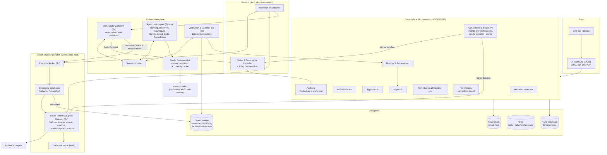
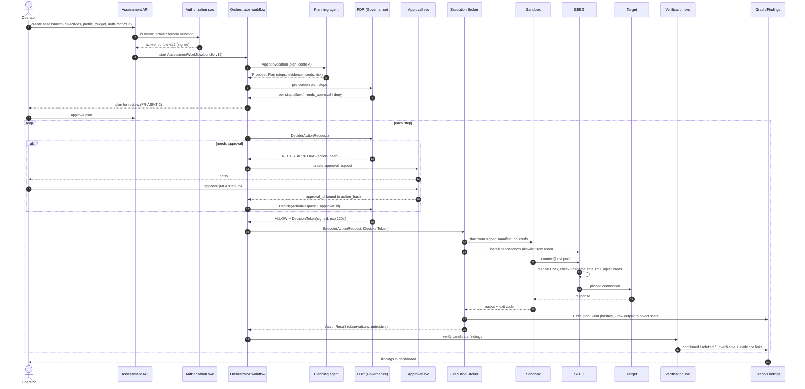

# 4. Complete system architecture

Status: `[SPEC]` unless marked. Technology choices are justified in
[15](15-infrastructure-deployment.md); this document describes structure and behaviour.

## 4.1 Architectural principles

1. **Propose / decide / execute / verify are four different components owned by four different
   trust levels.** Models propose; the PDP decides; the Execution Broker and sandboxes execute;
   the Verification service verifies. No component does two of these.
2. **Enforce twice, in different layers.** Every action is checked by the PDP before dispatch
   (logical check) and by the Scope-Enforcing Egress Gateway during execution (network check).
   A bug in one does not open scope.
3. **Durable by default.** All multi-step work is a durable workflow. Processes are disposable.
4. **Typed boundaries.** Every cross-component payload has a versioned schema. Free text from
   models or targets crosses boundaries only inside fields typed `untrusted_text`.
5. **Tenant is a first-class key** on every row, message, cache entry, object path, log line and
   sandbox label.
6. **Conventional engines do the testing.** Agents select, parameterize and interpret
   deterministic tools; they do not improvise shell.

## 4.2 Planes and components

### 4.2.1 Component responsibilities

| Component | Responsibility | State | Language | Status |
|---|---|---|---|---|
| API gateway | TLS termination, OIDC token validation, per-tenant request limits, WAF | None | Envoy | `[SPEC]` |
| Identity & Tenant svc | Tenants, users, groups, roles, SCIM, service identities | PG | Go | `[SPEC]` |
| Authorization & Scope svc | Authorization records, ownership verification, two-person activation, bundle compile + sign (Ed25519 via KMS) | PG, KMS | Go | `[SPEC]` |
| Assessment svc | Assessments, objectives, profiles, budgets; starts workflows | PG | Go | `[SPEC]` |
| Approval svc | Approval requests bound to action hashes; step-up MFA; single-use tokens | PG | Go | `[SPEC]` |
| **PDP (Safety & Governance Controller)** | Evaluates ActionRequests against the active signed bundle + capability catalogue + budgets + approvals + kill state. Returns signed decision tokens. No LLM, no network calls on the hot path. | In-memory bundle; budget counters in PG | Go | `[SPEC]` |
| Kill-switch broadcaster | Propagates tenant/global/assessment stop to PDP, Broker, SEEG, workflows | PG + NATS + direct gRPC fan-out | Go | `[SPEC]` |
| Temporal | Durable workflow state, timers, retries, task queues | Its own PG/Cassandra | Temporal | `[SPEC]` |
| Orchestrator workflows | Assessment and task state machines, budgets, scheduling, agent invocation | Temporal history | Go | `[SPEC]` |
| Agent runtime pool | Stateless role implementations; each invocation gets a context bundle and returns typed proposals | None | Python | `[SPEC]` |
| Model Gateway | Provider adapters, capability registry, routing, redaction, caching, accounting, refusal handling | PG (usage), Redis (cache) | Go | `[SPEC]` |
| Verification & Evidence svc | Runs deterministic verifiers; may request verification actions through the PDP like anyone else | PG, object store | Go | `[SPEC]` |
| Execution Broker | Validates decision token, materializes sandbox from signed manifest, injects per-action SEEG policy, collects output, enforces timeouts, cleans up | Ephemeral | Go | `[SPEC]` |
| Sandboxes | Run one tool invocation; no credentials at rest; only route is SEEG | Ephemeral | OCI images | `[SPEC]` |
| SEEG | The network enforcement point: resolves DNS itself, checks resolved IP + name against the action's allowlist, pins connection, enforces rate limits, injects credentials, captures traffic metadata/bodies to evidence | Ephemeral + Redis counters | Go | `[SPEC]` |
| Credential broker | Vault dynamic secrets / cloud STS with session policies; TTL ≤ action timeout | Vault | Vault | `[SPEC]` |
| Graph svc | Knowledge graph + execution-history graph API over PG | PG | Go | `[SPEC]` |
| Findings & Evidence svc | Findings lifecycle, evidence metadata, dedup | PG, object store | Go | `[SPEC]` |
| Remediation & Reporting | Recommendations, tickets, SLA, report rendering | PG, object store | Go + TS (render) | `[SPEC]` |
| Tool Registry | Signed manifests, image digests, capability classes, review status | PG, OCI registry | Go | `[SPEC]` |
| Audit svc | Append-only hash-chained log, periodic Merkle root anchoring to WORM bucket | PG + object store | Go | `[SPEC]` |

## 4.3 Communication model

| Path | Mechanism | Auth | Notes |
|---|---|---|---|
| Browser → API | HTTPS JSON (REST), SSE for live views | OIDC access token (≤10 min) + refresh; MFA step-up for approvals | See [09](09-api-specification.md) |
| Service ↔ service | gRPC over mTLS | SPIFFE workload identities; per-method authz policy | Every request carries `tenant_id` + caller principal; receiver re-checks |
| Workflow ↔ agent | Temporal activities on per-role task queues | Temporal mTLS + namespace per cell | Payloads are `AgentInvocation` / `AgentResult` envelopes ([09 §9.8](09-api-specification.md)); encrypted with a Temporal payload codec (tenant DEK) |
| Workflow → PDP | gRPC `Decide(ActionRequest)` | SPIFFE; only orchestrator and verifier identities may call | Returns signed `DecisionToken` |
| Workflow → Broker | gRPC `Execute(ActionRequest, DecisionToken)` | SPIFFE; Broker verifies token signature, expiry, action hash | Broker never calls the PDP to "ask again"; no token, no execution |
| Broker → SEEG | Per-sandbox policy push (gRPC) keyed by sandbox identity | SPIFFE | Policy = allowlist derived from the decision token, not from the request |
| Domain events | Transactional outbox in PG → NATS JetStream subjects `t.<tenant>.<type>` | NATS accounts per tenant | Consumers: UI SSE fan-out, integrations, metrics |
| Agents ↔ agents | **None directly.** All exchange is via the orchestrator and the graph | — | Prevents unmediated influence and injection propagation |

## 4.4 Core execution path

This is the path from the brief's architecture requirements, made concrete.

**No other path to targets exists.** Agents have no network route to targets (agent pods'
egress is restricted to the Model Gateway and Temporal). Sandboxes have no route except SEEG.
SEEG accepts connections only from sandboxes with an installed policy.

## 4.5 Failure domains and cells

- **Cell** = one Temporal namespace + one PG cluster + one execution node pool + one SEEG
  fleet, serving a set of tenants. Cells are the unit of scaling and blast radius
  ([15](15-infrastructure-deployment.md), [16](16-reliability-cost-scaling.md)).
- **Control plane failure** → no new assessments, running workflows pause at their next PDP
  call (PDP unavailable = deny, fail-closed).
- **Model provider failure** → agent activities retry with backoff, then route to an
  equivalent-capability model if policy allows; else the task parks in `waiting_model`.
- **Execution plane failure** → in-flight actions time out; the workflow retries according to the
  action's idempotency class ([09 §9.10](09-api-specification.md)).
- **SEEG failure** → sandboxes lose all egress (fail-closed).

## 4.6 Mode-specific topology

| Mode | Topology |
|---|---|
| A | Docker Compose or kind cluster on one host; synthetic target network on an internal bridge with **no default route**; Model Gateway may point to a local model server; SEEG allowlist = lab CIDR only. |
| B | Multi-tenant SaaS cell or single-tenant customer deployment; execution plane in a separate cluster/VPC with dedicated egress IPs published to customers for allowlisting. |
| C | Same as B but the capability ceiling is ≤ C3 and the execution plane may be reduced to API-reading workers; scheduled workflows; no interactive approvals required for C0–C2. |

## 4.7 What is deliberately not in the architecture

- No general-purpose shell tool for agents. Tools are manifests with typed parameters
  ([10 §10.3](10-secure-execution.md)). A "custom command" escape hatch exists only in Mode A.
- No agent-writable configuration. Agent prompts, tool sets and budgets come from versioned,
  signed configuration; agents cannot write them.
- No MITM of customer traffic outside the sandboxes' own outbound connections.
