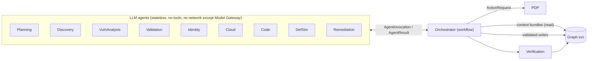
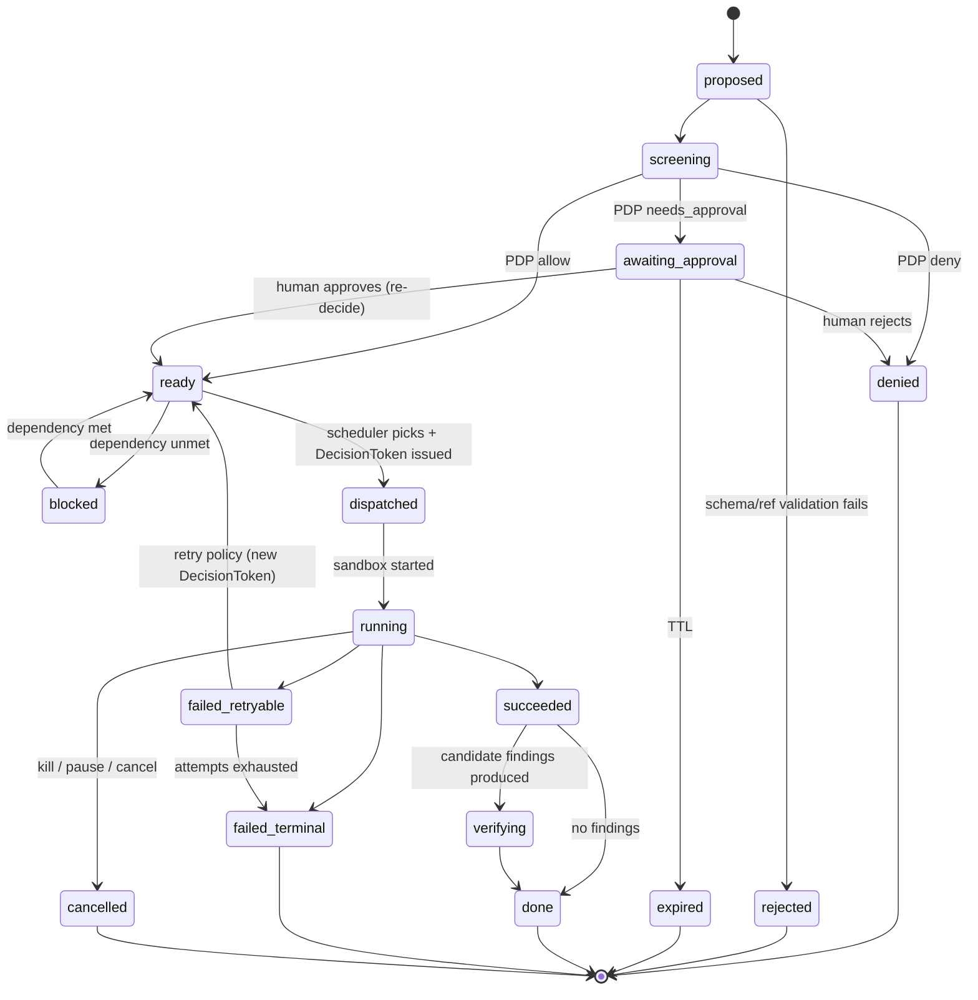

# 5. Multi-agent design

Status: `[SPEC]` for roles, contracts, lifecycle and pseudocode; `[CONCEPT]` for the
heuristics inside individual agent prompts, which must be tuned against the benchmark.

## 5.1 Two kinds of "agent"

The brief lists 12 roles. They are not all language-model agents:

| Kind | Roles | Why |
|---|---|---|
| **Deterministic services** (no LLM in the decision) | Orchestrator (workflow engine + state machine), Verification & Evidence, Safety & Governance Controller | These make decisions that must be reproducible and non-injectable. |
| **LLM-backed agents** (propose only) | Planning, Asset Discovery, Vulnerability Analysis, Validation (planner part), Identity, Cloud, Code, Defensive Simulation (planner part), Remediation | Their outputs are proposals, classifications or explanations that a deterministic component checks. |

An LLM-backed agent is a **stateless function**: `(AgentInvocation) → AgentResult`. It holds no
credentials, has no network route except to the Model Gateway, and cannot call tools directly.
It returns *proposed* `ActionRequest`s, *proposed* graph writes, and *hypotheses*. The
Orchestrator decides what to do with them.

## 5.2 Role specifications

For each role: purpose, inputs, outputs, capability classes it may *propose* (the PDP decides),
hard prohibitions, default model tier ([11 §11.4](11-ai-model-orchestration.md)).

### 1. Orchestrator (deterministic + optional LLM advisor)
- **Purpose**: Run the assessment state machine; allocate tasks; enforce budgets; schedule; recover.
- **Inputs**: Assessment spec, active bundle version, graph state, agent results, decisions.
- **Outputs**: Task records, agent invocations, ActionRequests to PDP, execution dispatches.
- **May**: Ask an LLM *advisor* to rank candidate next tasks (tier S/M). The ranking is a sort key, never a filter that bypasses checks.
- **Must not**: Grant permissions, modify scope or bundle, approve actions, raise budgets. It has no API for any of these (the methods do not exist on its service identity).

### 2. Planning agent
- **Purpose**: Turn objectives into a DAG of steps with dependencies, required evidence, risk and approval needs.
- **Inputs**: Objectives, scope summary (names, not credentials), testing profile, capability catalogue (tool names + parameter schemas + capability class), graph summary, execution-history summary.
- **Outputs**: `ProposedPlan { steps[] { id, intent, tool_ref, params, target_refs, depends_on, expected_evidence, risk_estimate, needs_approval_hint } }`.
- **Prohibitions**: Cannot reference targets not in the scope summary (validated by schema + PDP); cannot reference tools not in catalogue.
- **Tier**: L for initial plan, M for re-planning.

### 3. Asset Discovery agent
- **Purpose**: Choose discovery tools for registered roots and interpret results into asset observations.
- **Inputs**: Scope roots, discovery tool results (untrusted), existing inventory.
- **Outputs**: `AssetObservation[]` (raw, with source evidence ref), proposed follow-up discovery actions.
- **Prohibitions**: Discovered relationships (CNAMEs to SaaS, links, redirects, cloud trust targets) are recorded as `observed_out_of_scope` edges; the agent cannot propose actions on them. The PDP re-checks every observation before it becomes actionable.
- **Tier**: S (classification/extraction), M for ambiguous ownership reasoning.

### 4. Vulnerability Analysis agent
- **Purpose**: Correlate versions, configs, advisories (CVE/OSV/KEV/EPSS) and scanner results into hypotheses.
- **Outputs**: `Hypothesis { class, affected_asset, basis[] (evidence refs), status: potential, suggested_verifier }`.
- **Prohibitions**: May never set status beyond `potential`/`candidate`. Only Verification can confirm.
- **Tier**: M; L for multi-signal correlation.

### 5. Validation agent
- **Purpose**: Choose the least intrusive verifier and parameters for a hypothesis.
- **Outputs**: `VerificationPlan { verifier_id, params, environment: production_safe | isolated_replica }`.
- **Prohibitions**: `isolated_replica` only if the authorization record registers that replica and C6 is enabled; no data extraction beyond the benign marker the verifier defines; no destructive payloads exist in the catalogue.
- **Tier**: M.

### 6. Identity Security agent
- **Purpose**: Analyse principals, grants, consents, workload identities and trust edges from read-only IdP/cloud data.
- **Outputs**: Hypotheses with computed effective-permission paths (computed by the Graph svc's deterministic permission engine; the agent explains and prioritizes).
- **Prohibitions**: No sign-in, token minting, password or MFA testing (no such tools exist).
- **Tier**: M.

### 7. Cloud Security agent
- **Purpose**: Interpret CSPM-style rule results across AWS/Azure/GCP; reason about combinations (public + sensitive + no logging).
- **Outputs**: Hypotheses + remediation hints; proposals for C3 external reachability checks.
- **Prohibitions**: Read-only APIs only; IAM questions answered via policy simulators, never by attempting access.
- **Tier**: S for rule triage, M for combination reasoning.

### 8. Code Security agent
- **Purpose**: Triage SAST, SCA and secret-scanner output; reachability reasoning; supply-chain risk.
- **Inputs**: Tool results with **secrets already redacted at the scanner boundary** (fingerprint + type + location only).
- **Prohibitions**: Never receives, displays or exports full secrets (it cannot: they are not in its input).
- **Tier**: S for dedup/triage, M/L for reachability explanation.

### 9. Defensive Simulation agent
- **Purpose**: Select pre-approved scenarios from the signed scenario library that match the environment, and interpret detection results.
- **Prohibitions**: Cannot author new scenarios at runtime; scenarios execute only on hosts tagged `simulation_approved`.
- **Tier**: S/M.

### 10. Verification & Evidence service (deterministic)
- **Purpose**: Independently check every proposed finding against evidence.
- **Rule**: "A language model's claim of success never counts as proof." The verifier reads raw evidence (object store), never agent prose. Details in [07 §7.6](07-knowledge-graph.md) and [10 §10.8](10-secure-execution.md).
- **LLM use**: Optional *explanation* generation after the verdict, stored as `model_generated` text.

### 11. Remediation agent
- **Purpose**: Prioritized fixes, secure configuration, patch guidance, re-verification plan.
- **Inputs**: Confirmed findings, asset context, ownership, vendor advisories.
- **Outputs**: `Recommendation { steps, references, effort, reverify_plan(verifier_id, params) }`. The re-verification plan is the same verifier that confirmed the finding.
- **Tier**: M.

### 12. Safety & Governance Controller (deterministic)
- **Purpose**: Enforce scope, tool permissions, rate limits, budgets, approvals, emergency shutdown.
- **Implementation**: The PDP + kill-switch broadcaster + SEEG policy compiler. Specified in [10 §10.6](10-secure-execution.md). It has no LLM dependency and no network dependency on its decision path.

## 5.3 Communication model between agents



Rules:

1. **Hub-and-spoke only.** Agents never address each other. A "handoff" is the orchestrator
   creating a task for another role with a context bundle.
2. **Context bundles are assembled by code**, by query to the graph with the task's need-to-know
   filter (asset IDs, finding IDs, evidence summaries). Each item carries `trust` =
   `verified | platform | untrusted | model_generated`.
3. **Agent outputs are validated** against JSON Schema; unknown fields rejected; references
   (asset/tool/finding IDs) must resolve to objects the task may see. Free text goes into
   `rationale: untrusted_text` and is never parsed for instructions.
4. **Writes are proposals.** The orchestrator applies graph writes through the Graph svc,
   which enforces provenance, dedup and tenant ownership.

## 5.4 Task lifecycle



Each transition is an `ExecutionEvent` in the execution-history graph and an audit event.

## 5.5 Scheduling

The scheduler is part of the Orchestrator workflow, driven by Temporal task queues.

- **Queues**: per cell, per role (`agent.planning`, `agent.cloud`, …) and per execution class
  (`exec.network`, `exec.api_read`, `exec.code`). Separate queues prevent slow classes from
  starving fast ones.
- **Fairness**: weighted fair queuing across tenants (weight from plan tier), then across
  assessments within a tenant. Implemented as a per-cell "dispatcher" workflow that hands out
  execution slots (`[SPEC]`); Temporal worker concurrency caps the physical limit.
- **Per-asset concurrency**: at most `k` concurrent actions per asset (default 2) and per
  registered rate limit; enforced at dispatch (lease in PG `asset_locks`) and again in SEEG.
- **Priority** within an assessment: `priority = w1·risk_of_hypothesis + w2·coverage_gain −
  w3·cost_estimate − w4·intrusiveness`; ties broken by creation order. Weights live in the
  testing profile. The LLM advisor may supply `risk_of_hypothesis`; the rest is computed.
- **Dedup before dispatch**: compute `action_fingerprint = H(tenant, tool_id@version,
  canonical_params, target_set, evidence_window)`. If the execution-history graph has a
  `succeeded` execution with the same fingerprint inside its freshness window, reuse the result
  ([07 §7.9](07-knowledge-graph.md)).
- **Budgets**: tokens, model cost, sandbox-seconds, requests per asset, wall-clock. Checked at
  dispatch by the orchestrator (advisory) and by the PDP (authoritative).

## 5.6 Error recovery

| Failure | Detection | Recovery |
|---|---|---|
| Agent invocation error / timeout | Temporal activity timeout (start-to-close 120 s default, heartbeat 20 s) | Retry ×3 exponential (2 s → 30 s); then fallback model of same capability class; then task → `waiting_model`; operator notified |
| Agent output fails schema | Validator | One repair attempt with the validation error (same model); then `rejected` and counted in hallucination metrics |
| Tool execution timeout | Broker deadline | Sandbox killed; `failed_retryable` if action is idempotent class `I0/I1`, else `failed_terminal` |
| Sandbox crash / node loss | Broker heartbeat lost | Same as timeout; Temporal re-dispatches with **new** DecisionToken |
| Orchestrator worker crash | Temporal | Workflow replays from history on another worker; no duplicate side effects because activities are idempotent by `action_id` |
| PDP unavailable | gRPC error | Fail closed: task waits; alert |
| Kill switch | Broadcast | All running sandboxes for scope are terminated; workflows move tasks to `cancelled`; new decisions denied |
| Contradictory results | Verification | See 5.7 |

## 5.7 Conflict resolution

Conflicts are resolved by **fixed precedence**, not by negotiation between agents:

1. **Authority precedence**: Kill switch > PDP decision > human approval/rejection >
   Verification verdict > Orchestrator rules > agent proposals.
2. **Evidence precedence for facts**: verified observation > platform-derived fact > untrusted
   tool output > model-generated hypothesis. A higher class always wins for the same
   `(subject, predicate)`; within a class, newer `observed_at` wins; ties → `disputed`.
3. **Conflicting findings** (e.g. Cloud agent says bucket public, Verification says not
   reachable): Verification verdict stands; the hypothesis is stored as `refuted` with both
   evidence sets; if the verifier's evidence is older than the counter-signal, a fresh
   verification is scheduled once.
4. **Conflicting plans** (two agents propose actions on the same asset): dedup by fingerprint;
   otherwise per-asset concurrency lock decides order by priority score.
5. **Disputed state** is shown in the UI and requires either a second independent verifier run
   or a human decision. Humans can mark `refuted` or `confirmed_manual` (recorded as a human
   attestation, visibly distinct from automated confirmation).

## 5.8 Orchestration pseudocode

Benign orchestration only: it shows control flow and enforcement points. Written in Go-like
pseudocode for a Temporal workflow (deterministic: no I/O except via activities).

```go
// AssessmentWorkflow is deterministic. All I/O happens in activities.
func AssessmentWorkflow(ctx workflow.Context, in AssessmentInput) (AssessmentResult, error) {
    st := NewState(in) // budgets, bundle version, phase
    ctx = withActivityDefaults(ctx)

    // Kill/pause/cancel arrive as signals and are checked before every dispatch.
    ctl := workflow.GetSignalChannel(ctx, "control")

    plan := mustActivity[ProposedPlan](ctx, InvokeAgent, AgentInvocation{
        Role: "planning", TenantID: in.TenantID, AssessmentID: in.ID,
        Context: BuildContextRef{Kind: "plan_seed", BundleVersion: in.BundleVersion},
    })
    steps := ValidatePlan(plan, in.Catalogue)          // schema + reference checks (pure)
    screened := mustActivity[[]Screening](ctx, PDPScreen, steps)
    if !awaitPlanApproval(ctx, in, screened) {          // human review gate (signal)
        return st.Finish("plan_rejected"), nil
    }

    q := NewPriorityQueue(screened.Allowed())
    for !q.Empty() && !st.Stopped() {
        drainControl(ctl, st)                            // pause/cancel/kill
        if st.Paused() { workflow.Await(ctx, st.Resumed); continue }

        step := q.PopReady(st.Completed)                // dependency-aware
        if step == nil { workflow.Await(ctx, st.ProgressMade); continue }

        if hit := mustActivity[*CachedResult](ctx, LookupExecution, step.Fingerprint()); hit != nil {
            st.Record(step, hit); continue                 // execution-history reuse
        }

        req := step.ToActionRequest(in, st.NextAttempt(step))
        dec := mustActivity[Decision](ctx, PDPDecide, req)
        switch dec.Outcome {
        case Deny:
            st.Record(step, Denied(dec.Reasons)); continue
        case NeedsApproval:
            appr := requestAndAwaitApproval(ctx, req, dec)   // timer + signal
            if !appr.Granted { st.Record(step, Denied(appr.Reason)); continue }
            req.ApprovalID = appr.ID
            dec = mustActivity[Decision](ctx, PDPDecide, req) // re-decide; approval is an input, not a bypass
            if dec.Outcome != Allow { st.Record(step, Denied(dec.Reasons)); continue }
        }

        res, err := activity[ActionResult](ctx, Execute, ExecuteInput{req, dec.Token},
            RetryPolicyFor(step.Tool.IdempotencyClass))
        st.ChargeBudget(res.Usage)                       // tokens, sandbox-seconds, requests
        if err != nil { st.Record(step, Failed(err)); continue }

        obs := mustActivity[[]Observation](ctx, IngestObservations, res)  // typed, untrusted
        hyps := mustActivity[[]Hypothesis](ctx, InvokeAgent, analysisInvocation(step, obs))
        for _, h := range hyps {
            v := mustActivity[Verdict](ctx, Verify, h)    // deterministic verifiers
            st.RecordFinding(h, v)
        }
        for _, next := range mustActivity[[]PlanStep](ctx, InvokeAgent, replanInvocation(st)) {
            if s := ValidateStep(next, in.Catalogue); s != nil { q.Push(s) }
        }
        if st.BudgetExhausted() { st.EnterWrapUp() }
    }
    mustActivity[Empty](ctx, InvokeAgent, remediationInvocation(st))
    return st.Finish("completed"), nil
}
```

Properties this code guarantees, each with a test in [13](13-threat-model.md):

- Every `Execute` call is preceded by an `Allow` decision for the *same* request
  (the Broker re-verifies the token's `action_hash`).
- Approval is an **input** to the PDP, never a bypass: the PDP re-checks scope and budgets.
- Agent outputs only ever become `PlanStep`s after `ValidateStep`; they never reach `Execute` directly.
- Kill/pause signals are drained before each dispatch; the kill switch also acts out-of-band on
  the Broker and SEEG, so a stuck workflow cannot keep a sandbox alive.
