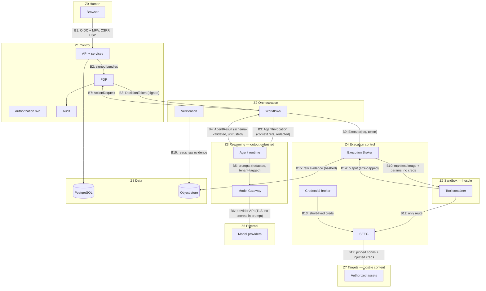
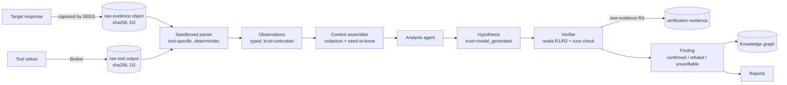

# 6. Data-flow and trust-boundary diagrams

Status: `[SPEC]`.

## 6.1 Trust zones

| Zone | Contents | Trust level | Who can write into it |
|---|---|---|---|
| **Z0 Human** | Operators, approvers, admins (browsers) | Authenticated, authorized per action | Humans via API |
| **Z1 Control** | Control-plane services, PDP, Audit, Authorization svc | Highest | Code deploys (signed images), humans via API |
| **Z2 Orchestration** | Temporal, orchestrator workflows, Verification | High | Z1, agent results (validated) |
| **Z3 Reasoning** | LLM agent runtime, Model Gateway | **Untrusted output** | Model providers (Z6), context bundles from Z2 |
| **Z4 Execution** | Execution Broker | High | Z2 with valid decision token |
| **Z5 Sandbox** | Ephemeral tool containers | **Hostile** (assume compromised) | Target responses, tool code |
| **Z6 External** | Model providers, threat-intel feeds, package mirrors | Third party | — |
| **Z7 Targets** | Customer assets | **Hostile content** | — |
| **Z8 Data** | PG, object store, Redis, NATS | Protected | Only Z1/Z2/Z4 services via authenticated clients |

## 6.2 Trust-boundary diagram

## 6.3 Boundary controls

| ID | Crossing | Threats | Controls | Test (see [13](13-threat-model.md)) |
|---|---|---|---|---|
| B1 | Human → API | Account takeover, CSRF, XSS, console exposure | OIDC + phishing-resistant MFA for approvers; short tokens; SameSite=strict cookies + CSRF token; strict CSP; no public unauthenticated routes except `/healthz` on internal port | T-AUTH-* |
| B2 | Authorization svc → PDP/SEEG | Bundle tampering, rollback | Ed25519 signature (KMS key), monotonic version, PDP refuses older version than last seen per tenant | T-BUNDLE-1..3 |
| B3 | Workflow → Agent | Over-sharing, cross-tenant leak, secret leak | Need-to-know context assembly; tenant tag check; redaction pass; secrets never in graph | T-CTX-1..4 |
| B4 | Agent → Workflow | Injection-driven proposals, malformed output | JSON Schema, ID resolution against task-visible set, unknown-field rejection, size caps | T-AGENT-1..5 |
| B5/B6 | → Model providers | Data residency, prompt leakage, provider retention | Per-tenant provider allowlist; zero-retention endpoints where offered; PII/secret redaction; prompts logged encrypted per tenant | T-MG-1..4 |
| B7/B8 | Workflow ↔ PDP | Forged decisions, replay | Only orchestrator/verifier SPIFFE IDs may call; token binds `action_hash`, `tenant`, `bundle_version`, `exp` ≤120 s, `jti` single-use | T-PDP-1..6 |
| B9 | Workflow → Broker | Execution without decision | Broker verifies token signature, hash, expiry, jti unused; re-hashes request canonically | T-EXEC-1..3 |
| B10 | Broker → Sandbox | Malicious tool image, param injection | Image by digest from signed manifest (cosign); params rendered from typed schema into argv (no shell); read-only rootfs | T-SBX-1..6 |
| B11 | Sandbox → SEEG | Bypass egress, DNS tricks | Network policy: sandbox can reach only SEEG; SEEG does DNS itself; IP literals checked; no raw sockets (CAP_NET_RAW dropped) | T-NET-1..9 |
| B12 | SEEG → Targets | Scope escape via redirect/rebinding/CNAME | Per-connection resolve+check+pin; redirects re-evaluated; per-asset rate limits | T-NET-* |
| B13 | Credential injection | Credential theft by tool | Creds injected at SEEG for HTTP APIs (tool never sees them); where SDK needs creds, STS session policy scoped to read-only actions + TTL ≤ timeout | T-CRED-1..4 |
| B14/B15 | Sandbox output | Malicious output (injection, zip bombs, huge payloads) | Size caps, MIME sniffing, content hashing, stored as untrusted; parsers run in sandboxed parse step | T-OUT-1..4 |
| B16 | Verification reads evidence | Evidence tampering | Content-addressed objects; hash recorded in PG and audit chain; object lock | T-EVID-1..3 |

## 6.4 Data classification and flows

| Class | Examples | Allowed in model prompts? | Storage | Retention default |
|---|---|---|---|---|
| D0 Public | CVE text, advisories | Yes | PG | Indefinite |
| D1 Tenant-internal | Asset names, configs, finding summaries | Yes, if tenant model policy allows | PG (RLS) | Tenant policy |
| D2 Sensitive | HTTP bodies, source code excerpts, user lists | Minimized excerpts only, after PII redaction, tenant opt-in | Object store, per-tenant DEK | 13 months |
| D3 Secret | Credentials, tokens, keys found or used | **Never** | Vault (used creds); fingerprints only for found secrets | Found-secret fingerprints: life of finding |
| D4 Audit | Audit chain | No | PG + WORM | 7 years |

### 6.4.1 A finding's data flow end to end

The analysis agent never sees `R1/R2` directly unless the context assembler includes a
redacted excerpt. The verifier never reads `H.rationale`; it reads only `H.class`,
`H.affected_asset`, `H.basis` references, and the verifier parameters.

## 6.5 Cross-tenant isolation flow

Tenant identity is established once at B1 (token `tid` claim, validated against user
membership) and then **carried, not re-derived**:

1. API sets `app.tenant_id` on the PG session (`SET LOCAL`) before any query; RLS policies
   filter every table ([08 §8.3](08-database-design.md)).
2. Every gRPC call carries tenant in metadata; the receiver checks it against the caller's
   SPIFFE identity allowances and the resource's tenant.
3. Temporal: one namespace per cell; workflow IDs prefixed with tenant; payload codec encrypts
   with the tenant DEK, so a mis-routed payload is unreadable.
4. NATS: one account per tenant; subjects `t.<tenant>.*`.
5. Object store: prefix `tenants/<tenant>/…` and per-tenant KMS key; bucket policy denies
   access without the tenant tag on the role session.
6. Redis: key prefix `t:<tenant>:`; no cross-tenant key enumeration commands allowed to app user.
7. Sandboxes: labelled with tenant; SEEG policy keyed by sandbox identity; nodes optionally
   dedicated per tenant (enterprise tier).
8. Model Gateway: cache key includes tenant; no cross-tenant semantic cache.
