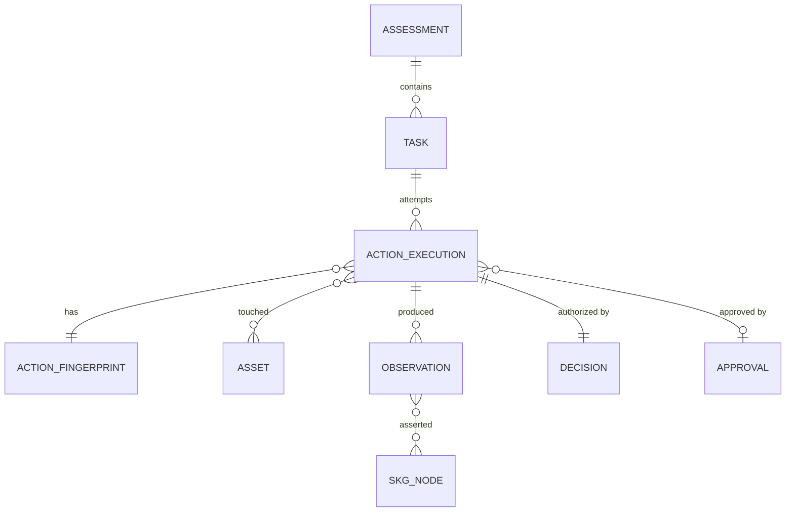

# 7. Knowledge graph schema

Status: `[SPEC]` for schema, provenance, dedup and versioning; `[CONCEPT]` for the risk
formula weights; `[RESEARCH]` for automated cross-cloud effective-permission computation at
full fidelity (provider semantics such as AWS SCPs/permission boundaries/session policies and
Azure deny assignments are large; we start with a documented subset).

## 7.1 Two graphs

| Graph | Question it answers | Mutability | Scope |
|---|---|---|---|
| **Security Knowledge Graph (SKG)** | What exists, how it is connected, what is wrong with it, what proves it | Bitemporal, versioned | Tenant-wide, shared across assessments |
| **Execution-History Graph (EHG)** | What was done, by whom, with what inputs, what it produced, is it still fresh | Append-only | Tenant-wide, indexed by assessment |

ARTEX had the same split (asset graph vs per-task exploration graph) `[CODE]`. AEGIS-X adds
identities, permissions and trust edges to the SKG, makes every edge carry provenance, and makes
the EHG tenant-wide so previous assessments prevent redundant work.

## 7.2 Common envelope (every node and every edge)

```yaml
id:              uuid v7                 # time-ordered
tenant_id:       uuid                    # RLS key; immutable
type:            enum                    # see 7.3 / 7.4
natural_key:     text                    # canonical dedup key (7.5); unique per (tenant, type)
props:           jsonb                   # validated against JSON Schema for `type`@schema_version
schema_version:  int
trust_class:     verified | platform | untrusted | model_generated | human_attested
confidence:      numeric(4,3)            # 0..1; meaning depends on trust_class (7.6)
provenance:
  source_kind:   connector | tool_execution | verifier | agent | human | import
  source_id:     uuid                    # ExecutionEvent / connector sync / user id
  evidence_refs: [uuid]                  # Evidence ids (sha256-addressed objects)
  method:        text                    # e.g. "aws:config:DescribeBucketPolicy"
observed_at:     timestamptz             # when the fact was true in the world
valid_from:      timestamptz             # bitemporal: world time
valid_to:        timestamptz | null
recorded_at:     timestamptz             # bitemporal: system time
superseded_by:   uuid | null
expires_at:      timestamptz | null      # freshness (7.8)
scope_state:     in_scope | observed_out_of_scope | excluded   # computed by PDP, not by agents
```

## 7.3 Node types

| Type | Key props | Natural key |
|---|---|---|
| `Organization` | name | tenant root |
| `BusinessUnit` | name, owner | `bu:<slug>` |
| `Domain` | fqdn, registrar | `dns:<fqdn lowercased, IDNA>` |
| `Host` | hostname, os, criticality | `host:<cloud-instance-id>` or `host:<fqdn>` |
| `IPAddress` | ip, asn | `ip:<canonical>` |
| `Service` | port, proto, product, version | `svc:<ip or host>:<proto>/<port>` |
| `Application` | name, url, framework | `app:<scheme>://<host>:<port><base_path>` |
| `APIEndpoint` | method, path_template, auth | `api:<app_key>:<METHOD>:<template>` |
| `Repository` | provider, full_name, default_branch | `repo:<provider>:<full_name>` |
| `SoftwareComponent` | ecosystem, name, version, purl | `purl:<package-url>` |
| `CloudAccount` | provider, account_id | `cloud:<provider>:<account>` |
| `CloudResource` | provider, arn/resource_id, kind, region, tags | `res:<provider>:<canonical id>` |
| `Identity` | kind (user/group/service_principal/role/workload/oauth_app), provider, display_name, last_used_at | `id:<provider>:<object id>` |
| `Permission` | action set, resource pattern, conditions | `perm:<provider>:<policy id>:<stmt hash>` |
| `Credential` | kind, fingerprint (HMAC), created_at, last_rotated_at, expires_at | `cred:<provider>:<fingerprint>` (never value) |
| `Vulnerability` | cve/ghsa/osv id, cvss, epss, kev | `vuln:<id>` |
| `Weakness` | CWE / misconfiguration rule id | `weak:<rule id>` |
| `Hypothesis` | class, rationale (untrusted_text), status | `hyp:<assessment>:<fingerprint>` |
| `Finding` | class, severity, risk_score, status, lifecycle | `find:<fingerprint>` (7.5) |
| `Evidence` | kind, sha256, mime, size, redaction_state, object_uri | `ev:<sha256>` |
| `Remediation` | status, owner, due_at, ticket_ref | `rem:<finding id>` |
| `Control` | kind (detection/prevention), product, rule id | `ctl:<product>:<rule>` |
| `AssessmentRun` | assessment_id, started_at | `run:<id>` |

## 7.4 Edge types

| Edge | From → To | Meaning |
|---|---|---|
| `CONTAINS` | Domain→Domain, CloudAccount→CloudResource, Host→Service, Application→APIEndpoint | Structural containment |
| `RESOLVES_TO` | Domain→IPAddress | DNS answer (time-bounded) |
| `ALIASES` | Domain→Domain | CNAME (may point out of scope) |
| `RUNS` | Host/Service/CloudResource→Application/SoftwareComponent | Deployment |
| `DEPENDS_ON` | Application/Repository/SoftwareComponent→SoftwareComponent | Dependency (direct/transitive in props) |
| `BUILT_FROM` | Application→Repository | Provenance |
| `HAS_IDENTITY` | Host/CloudResource/Application→Identity | Workload identity |
| `MEMBER_OF` | Identity→Identity | Group/role membership |
| `GRANTED` | Identity→Permission | Assignment (direct/inherited) |
| `APPLIES_TO` | Permission→CloudResource/CloudAccount/Application | Resource scope |
| `CAN_ASSUME` / `TRUSTS` | Identity→Identity, CloudAccount→CloudAccount | Trust relationships (incl. cross-account, federated, OAuth consent) |
| `CONSENTED` | Identity(user/admin)→Identity(oauth_app) | OAuth grant (scopes in props) |
| `HAS_CREDENTIAL` | Identity→Credential | Credential ownership |
| `EXPOSED_IN` | Credential→Repository/Evidence | Found secret location (fingerprint only) |
| `AFFECTS` | Vulnerability/Weakness→SoftwareComponent/CloudResource/Service | Applicability |
| `SUGGESTS` | Hypothesis→Finding candidate | Model proposal |
| `INSTANCE_OF` | Finding→Vulnerability/Weakness | Classification |
| `FOUND_ON` | Finding→any asset node | Affected asset |
| `SUPPORTED_BY` / `CONTRADICTED_BY` | Finding/Hypothesis→Evidence | Evidence links with role (`basis`, `verification`, `counter`) |
| `REMEDIATED_BY` | Finding→Remediation | Fix tracking |
| `DETECTED_BY` | Simulation result→Control | Detection validation |
| `REACHABLE_FROM` | asset→asset | Computed exposure/attack-path edge (derived, `trust_class=platform`) |

Every edge carries the full envelope in 7.2. An edge with `trust_class=model_generated` is
never used in derived computations (reachability, risk) except in explicitly labelled
"hypothetical path" views.

## 7.5 Deduplication

- **Asset nodes**: `natural_key` computed by code from canonicalized props (lowercased IDNA
  hostnames, canonical IPv6, provider canonical ARNs/resource IDs, purl normalization). Upsert
  on `(tenant_id, type, natural_key)`. Agents submit raw observations; they never compute keys
  (the same rule ARTEX applies `[CODE]`).
- **Findings**: `fingerprint = sha256(tenant ‖ weakness_or_vuln_id ‖ canonical_affected_asset_key ‖
  location_discriminator)`, where `location_discriminator` is class-specific (e.g. parameter name
  + endpoint template for web, policy statement hash for IAM, file path + rule + line-normalized
  snippet hash for code). The same fingerprint across assessments = same finding, new
  `SUPPORTED_BY` evidence and a new observation timestamp.
- **Evidence**: content-addressed (`sha256`); identical bytes stored once per tenant.
- **Near-duplicates** (e.g. same vuln on 300 hosts): grouped via `FindingGroup` keyed on
  `weakness_id + remediation_key`, so the user sees one remediation with 300 affected assets.

## 7.6 Confidence semantics

Confidence is never a single model number:

| trust_class | Confidence means | Source |
|---|---|---|
| `verified` | Verifier-defined strength: 1.0 for direct state read (API says bucket ACL is public-read); 0.9 for two independent corroborating signals; 0.7 single active-check signal | Verifier registry, per verifier, fixed |
| `platform` | Deterministic derivation strength (e.g. reachability computed from verified edges = min of inputs) | Graph engine |
| `untrusted` | Tool-reported confidence mapped through a calibration table per tool | Tool manifest |
| `model_generated` | Calibrated model confidence (see [11 §11.9](11-ai-model-orchestration.md)); displayed as "hypothesis confidence" | Model Gateway |
| `human_attested` | 1.0, with attester identity | Human |

## 7.7 Risk scoring (`[CONCEPT]`, weights to be tuned)

```
risk = severity_base(cvss_or_rule)                 # 0..10
     × exploit_evidence_factor                     # verified exploitability 1.0, KEV 0.9, EPSS-scaled 0.3..0.8, none 0.3
     × exposure_factor                             # internet-reachable (verified) 1.0, internal 0.5, isolated 0.2
     × asset_criticality                           # from CMDB/tags 0.5..1.5
     × blast_radius_factor                         # 1 + log10(1 + #resources reachable via identity paths) capped at 2.0
```

All factors are computed from `verified` or `platform` edges only. The UI shows each factor.

## 7.8 Versioning and evidence expiration

- **Bitemporal**: updates never overwrite. A change inserts a new version row with
  `valid_from = observed_at`, sets `valid_to` and `superseded_by` on the prior one. "As of"
  queries reconstruct the graph at any time (needed for reports and audits).
- **Freshness**: each evidence `kind` has a TTL in the verifier registry (e.g. TLS config 7 d,
  cloud config 24 h in Mode C, dependency manifest until next commit, DNS 1 h). Past
  `expires_at`, findings supported only by expired evidence become `stale`; Mode C schedules
  re-verification; Mode B surfaces them as "last verified at".
- **Retention**: evidence objects follow tenant retention; deleting an evidence object keeps its
  hash and metadata (tombstone) so audit chains still verify.

## 7.9 Execution-History Graph



- `ACTION_FINGERPRINT = sha256(tenant ‖ tool_id@version ‖ canonical_params ‖ sorted(target_keys))`.
- Reuse rule: before dispatch, look up the latest `succeeded` execution with the same
  fingerprint where `now < finished_at + freshness(tool_class)` and the tool version is equal.
  If found, link the new task to the old execution (`REUSED`) instead of executing.
- Coverage: `coverage(asset, check_class) = exists succeeded execution of a tool in class within
  freshness window`. Coverage dashboards and the planner's "what has been tested" context are
  computed from this, not from agent memory.
- Negative results are first-class: an execution that found nothing is still recorded, so the
  planner does not retry it.

## 7.10 How agents query and update

Agents never write queries. The Graph svc exposes **typed query templates**:

| Template | Returns | Used by |
|---|---|---|
| `assets.in_scope(assessment, types, page)` | Asset summaries | Planning, Discovery |
| `assets.neighbors(asset, edge_types, depth≤3)` | Subgraph (scope-filtered) | Analysis agents |
| `coverage.gaps(assessment, check_classes)` | Untested asset × class pairs | Planning |
| `findings.for_asset(asset, statuses)` | Findings with evidence summaries | Remediation |
| `identity.effective_permissions(identity, resource_scope)` | Computed permission set + path | Identity agent |
| `paths.exposure(asset)` | Verified reachability paths | Vuln analysis, risk |
| `history.executions(asset, tool_class, since)` | Execution summaries | Planning (dedup) |

Writes go through `ProposeObservations(execution_id, observations[])`, which: validates schema;
resolves natural keys; asks the PDP to compute `scope_state`; sets `trust_class=untrusted` (tool
derived) or `model_generated` (agent derived); attaches provenance from the execution; upserts.
Only the Verification svc can write `trust_class=verified`; only humans can write
`human_attested`.

## 7.11 Conflict resolution on write

Given an incoming assertion `(subject, predicate, value)` with class `c_new` and existing current
version with class `c_old`:

```
rank = {verified:5, human_attested:5, platform:4, untrusted:2, model_generated:1}
if rank[c_new] > rank[c_old]: supersede
elif rank[c_new] < rank[c_old]: store as non-current alternative (visible in history)
else:  # same rank
    if observed_at_new > observed_at_old: supersede
    elif values equal: merge provenance (add evidence_refs)
    else: mark subject `disputed`, keep both, schedule verification
```

`human_attested` vs `verified` disagreement is never auto-resolved; it is flagged for review.

## 7.12 Storage decision

PostgreSQL tables (`graph_nodes`, `graph_edges`, `graph_node_versions`) with JSONB props, GIN
indexes, and recursive CTEs for bounded traversals (depth ≤ 6). Justification and the conditions
under which to add a dedicated graph engine are in [15 §15.2](15-infrastructure-deployment.md).
DDL is in [08](08-database-design.md).
