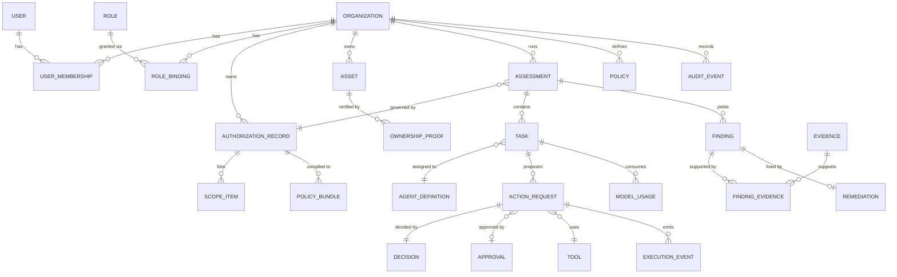

# 8. Database design

Status: `[SPEC]`. PostgreSQL 16+. This DDL is the Milestone 1 starting point; migrations are
forward-only (a published migration is never edited).

## 8.1 Entity overview



"Organization" is the tenant. "Scope" is represented by `authorization_records` +
`scope_items` (+ the compiled `policy_bundles`). "Agent" is `agent_definitions` (versioned role
config).

## 8.2 DDL

```sql
-- ===== Conventions =====
-- uuid v7 primary keys generated in app; every tenant-owned table has tenant_id NOT NULL;
-- created_at/updated_at timestamptz; enums as text + CHECK for forward-compatible migrations.

CREATE EXTENSION IF NOT EXISTS pgcrypto;
CREATE EXTENSION IF NOT EXISTS btree_gist;

-- ===== Tenancy & identity =====
CREATE TABLE organizations (
  id            uuid PRIMARY KEY,
  slug          text NOT NULL UNIQUE CHECK (slug ~ '^[a-z0-9-]{3,63}$'),
  name          text NOT NULL,
  plan_tier     text NOT NULL DEFAULT 'standard',
  data_region   text NOT NULL,                       -- residency constraint for storage + models
  kill_state    text NOT NULL DEFAULT 'running' CHECK (kill_state IN ('running','halted')),
  created_at    timestamptz NOT NULL DEFAULT now()
);

CREATE TABLE users (
  id            uuid PRIMARY KEY,
  oidc_issuer   text NOT NULL,
  oidc_subject  text NOT NULL,
  email         citext NOT NULL,
  display_name  text NOT NULL,
  disabled_at   timestamptz,
  UNIQUE (oidc_issuer, oidc_subject)
);

CREATE TABLE user_memberships (
  tenant_id     uuid NOT NULL REFERENCES organizations(id),
  user_id       uuid NOT NULL REFERENCES users(id),
  status        text NOT NULL DEFAULT 'active' CHECK (status IN ('active','suspended')),
  PRIMARY KEY (tenant_id, user_id)
);

CREATE TABLE roles (                                  -- system roles are tenant_id NULL
  id            uuid PRIMARY KEY,
  tenant_id     uuid REFERENCES organizations(id),
  name          text NOT NULL,                        -- e.g. assessment_owner, authorization_approver
  permissions   text[] NOT NULL,                      -- Cedar action names
  UNIQUE (tenant_id, name)
);

CREATE TABLE role_bindings (
  id            uuid PRIMARY KEY,
  tenant_id     uuid NOT NULL REFERENCES organizations(id),
  principal_id  uuid NOT NULL,                        -- user or group id
  principal_kind text NOT NULL CHECK (principal_kind IN ('user','group','service')),
  role_id       uuid NOT NULL REFERENCES roles(id),
  resource_scope jsonb NOT NULL DEFAULT '{}',         -- ABAC: e.g. {"business_unit":"payments"}
  expires_at    timestamptz,
  created_by    uuid NOT NULL
);

-- ===== Assets & ownership =====
CREATE TABLE assets (                                 -- registry of *registrable* roots
  id            uuid PRIMARY KEY,
  tenant_id     uuid NOT NULL REFERENCES organizations(id),
  kind          text NOT NULL CHECK (kind IN ('domain','cidr','host','url','cloud_account','repo_org','repo','idp_tenant','replica_env')),
  value         text NOT NULL,                        -- canonical form
  criticality   numeric(3,2) NOT NULL DEFAULT 1.0,
  owner_group   text,
  ownership_state text NOT NULL DEFAULT 'unverified' CHECK (ownership_state IN ('unverified','verified','revoked')),
  UNIQUE (tenant_id, kind, value)
);

CREATE TABLE ownership_proofs (
  id            uuid PRIMARY KEY,
  tenant_id     uuid NOT NULL,
  asset_id      uuid NOT NULL REFERENCES assets(id),
  method        text NOT NULL CHECK (method IN ('dns_txt','http_wellknown','cloud_role_assumption','scm_app_install','idp_app_consent','manual_attestation')),
  challenge     text NOT NULL,
  verified_at   timestamptz,
  verified_by   uuid,                                 -- user for manual_attestation (requires 2nd approver)
  evidence_id   uuid,
  expires_at    timestamptz NOT NULL
);

-- ===== Authorization (scope) =====
CREATE TABLE authorization_records (
  id            uuid PRIMARY KEY,
  tenant_id     uuid NOT NULL REFERENCES organizations(id),
  version       int  NOT NULL,
  lineage_id    uuid NOT NULL,                        -- same across versions
  mode          text NOT NULL CHECK (mode IN ('A','B','C')),
  capability_ceiling text NOT NULL CHECK (capability_ceiling ~ '^C[0-8]$'),
  enabled_flags text[] NOT NULL DEFAULT '{}',         -- e.g. {'C5_test_accounts','C6_replica'}
  rate_limits   jsonb NOT NULL,                       -- per asset kind: rps, burst, concurrency
  time_windows  jsonb NOT NULL,                       -- cron-like allowed windows + tz
  valid_from    timestamptz NOT NULL,
  valid_to      timestamptz NOT NULL,
  budgets       jsonb NOT NULL,                       -- max tokens, cost, sandbox-seconds
  contacts      jsonb NOT NULL,
  state         text NOT NULL CHECK (state IN ('draft','pending_approval','active','superseded','revoked','expired')),
  created_by    uuid NOT NULL,
  approved_by   uuid,
  approved_at   timestamptz,
  content_hash  bytea NOT NULL,                       -- sha256 over canonical JSON incl. scope_items
  CHECK (valid_to > valid_from),
  CHECK (approved_by IS NULL OR approved_by <> created_by),   -- two-person rule
  UNIQUE (lineage_id, version)
);
-- At most one active version per lineage:
CREATE UNIQUE INDEX one_active_per_lineage ON authorization_records(lineage_id) WHERE state = 'active';

CREATE TABLE scope_items (
  id            uuid PRIMARY KEY,
  tenant_id     uuid NOT NULL,
  authorization_id uuid NOT NULL REFERENCES authorization_records(id),
  effect        text NOT NULL CHECK (effect IN ('include','exclude')),
  asset_id      uuid REFERENCES assets(id),           -- includes must reference a verified asset
  pattern_kind  text NOT NULL CHECK (pattern_kind IN ('exact_host','subdomains_of','cidr','url_prefix','cloud_account','cloud_resource_arn_prefix','repo','repo_org')),
  pattern       text NOT NULL,
  ports         int4range[],                          -- optional port restriction
  capabilities  text[]                                -- optional narrower ceiling for this item
);

CREATE TABLE policy_bundles (
  id            uuid PRIMARY KEY,
  tenant_id     uuid NOT NULL,
  authorization_id uuid NOT NULL REFERENCES authorization_records(id),
  bundle_version bigint NOT NULL,                     -- monotonic per tenant
  compiled      bytea NOT NULL,                       -- canonical CBOR of compiled matchers
  signature     bytea NOT NULL,                       -- Ed25519 over compiled
  key_id        text NOT NULL,
  created_at    timestamptz NOT NULL DEFAULT now(),
  UNIQUE (tenant_id, bundle_version)
);

CREATE TABLE policies (                               -- tenant governance policies (non-scope)
  id            uuid PRIMARY KEY,
  tenant_id     uuid NOT NULL,
  kind          text NOT NULL CHECK (kind IN ('approval','model','retention','sla','notification')),
  version       int NOT NULL,
  body          jsonb NOT NULL,                       -- Cedar text or structured settings
  state         text NOT NULL CHECK (state IN ('draft','active','retired')),
  approved_by   uuid,
  UNIQUE (tenant_id, kind, version)
);

-- ===== Tools & agents =====
CREATE TABLE tools (                                  -- signed manifests (global catalogue; tenant_id NULL) or tenant-private (Mode A only)
  id            uuid PRIMARY KEY,
  tenant_id     uuid,
  name          text NOT NULL,
  version       text NOT NULL,
  capability_class text NOT NULL CHECK (capability_class ~ '^C[0-8]$'),
  idempotency_class text NOT NULL CHECK (idempotency_class IN ('I0','I1','I2')),
  image_digest  text NOT NULL CHECK (image_digest ~ '^sha256:[a-f0-9]{64}$'),
  manifest      jsonb NOT NULL,                       -- param schema, egress needs, resources, parsers
  signature     bytea NOT NULL,
  review_state  text NOT NULL CHECK (review_state IN ('pending','approved','revoked')),
  UNIQUE (name, version)
);

CREATE TABLE agent_definitions (
  id            uuid PRIMARY KEY,
  role          text NOT NULL CHECK (role IN ('planning','discovery','vuln_analysis','validation','identity','cloud','code','def_sim','remediation','orchestrator_advisor')),
  version       int NOT NULL,
  prompt_ref    text NOT NULL,                        -- content-addressed prompt template
  output_schema jsonb NOT NULL,
  model_policy  jsonb NOT NULL,                       -- tier, allowed capability classes
  allowed_tool_classes text[] NOT NULL,               -- what it may PROPOSE
  UNIQUE (role, version)
);

-- ===== Assessments, tasks, actions =====
CREATE TABLE assessments (
  id            uuid PRIMARY KEY,
  tenant_id     uuid NOT NULL,
  authorization_id uuid NOT NULL REFERENCES authorization_records(id),
  bundle_version bigint NOT NULL,
  name          text NOT NULL,
  objectives    jsonb NOT NULL,
  profile       text NOT NULL,
  budgets       jsonb NOT NULL,                       -- must be <= authorization budgets (checked in app + trigger)
  state         text NOT NULL CHECK (state IN ('draft','planning','awaiting_plan_review','running','paused','wrapping_up','completed','cancelled','failed')),
  workflow_id   text UNIQUE,
  created_by    uuid NOT NULL,
  created_at    timestamptz NOT NULL DEFAULT now()
);

CREATE TABLE tasks (
  id            uuid PRIMARY KEY,
  tenant_id     uuid NOT NULL,
  assessment_id uuid NOT NULL REFERENCES assessments(id),
  agent_role    text NOT NULL,
  agent_version int NOT NULL,
  parent_task_id uuid REFERENCES tasks(id),
  state         text NOT NULL,                        -- see 05 §5.4
  priority      numeric NOT NULL DEFAULT 0,
  depends_on    uuid[] NOT NULL DEFAULT '{}',
  attempt       int NOT NULL DEFAULT 0,
  created_at    timestamptz NOT NULL DEFAULT now(),
  updated_at    timestamptz NOT NULL DEFAULT now()
);
CREATE INDEX tasks_assessment_state ON tasks(tenant_id, assessment_id, state);

CREATE TABLE action_requests (
  id            uuid PRIMARY KEY,                     -- action_id; idempotency key for execution
  tenant_id     uuid NOT NULL,
  task_id       uuid NOT NULL REFERENCES tasks(id),
  tool_id       uuid NOT NULL REFERENCES tools(id),
  params        jsonb NOT NULL,                       -- canonicalized
  targets       jsonb NOT NULL,                       -- [{kind, value}] canonical
  action_hash   bytea NOT NULL,                       -- sha256(canonical request)
  fingerprint   bytea NOT NULL,                       -- dedup key (07 §7.9)
  attempt       int NOT NULL,
  created_at    timestamptz NOT NULL DEFAULT now(),
  UNIQUE (task_id, attempt)
);
CREATE INDEX action_fingerprint ON action_requests(tenant_id, fingerprint);

CREATE TABLE decisions (
  id            uuid PRIMARY KEY,
  tenant_id     uuid NOT NULL,
  action_id     uuid NOT NULL REFERENCES action_requests(id),
  outcome       text NOT NULL CHECK (outcome IN ('allow','deny','needs_approval')),
  reasons       text[] NOT NULL,                      -- stable reason codes
  bundle_version bigint NOT NULL,
  pdp_version   text NOT NULL,
  token_jti     uuid UNIQUE,                          -- set when outcome = allow
  token_exp     timestamptz,
  token_used_at timestamptz,                          -- single use, set by Broker
  decided_at    timestamptz NOT NULL DEFAULT now()
);

CREATE TABLE approvals (
  id            uuid PRIMARY KEY,
  tenant_id     uuid NOT NULL,
  action_hash   bytea NOT NULL,                       -- binds to exact action
  requested_for uuid NOT NULL REFERENCES action_requests(id),
  required_approvers int NOT NULL DEFAULT 1,
  state         text NOT NULL CHECK (state IN ('pending','granted','rejected','expired','consumed')),
  expires_at    timestamptz NOT NULL,
  created_at    timestamptz NOT NULL DEFAULT now()
);
CREATE TABLE approval_votes (
  approval_id   uuid NOT NULL REFERENCES approvals(id),
  tenant_id     uuid NOT NULL,
  approver_id   uuid NOT NULL,                        -- must be a user; no service principals
  vote          text NOT NULL CHECK (vote IN ('grant','reject')),
  mfa_at        timestamptz NOT NULL,                 -- step-up timestamp (<= 5 min before vote)
  comment       text,
  voted_at      timestamptz NOT NULL DEFAULT now(),
  PRIMARY KEY (approval_id, approver_id)
);

-- ===== Execution history (partitioned) =====
CREATE TABLE execution_events (
  id            uuid NOT NULL,
  tenant_id     uuid NOT NULL,
  action_id     uuid,
  task_id       uuid,
  assessment_id uuid NOT NULL,
  seq           bigint NOT NULL,                      -- per-assessment monotonic
  type          text NOT NULL,                        -- schema in 09 §9.7
  payload       jsonb NOT NULL,
  occurred_at   timestamptz NOT NULL,
  PRIMARY KEY (tenant_id, occurred_at, id)
) PARTITION BY RANGE (occurred_at);
-- monthly partitions created by a maintenance job

-- ===== Evidence & findings =====
CREATE TABLE evidence (
  id            uuid PRIMARY KEY,
  tenant_id     uuid NOT NULL,
  sha256        bytea NOT NULL,
  kind          text NOT NULL,                        -- http_exchange, api_response, tool_stdout, file_excerpt, screenshot, verifier_trace
  mime          text NOT NULL,
  size_bytes    bigint NOT NULL,
  object_uri    text,                                 -- NULL after retention purge (tombstone)
  redaction_state text NOT NULL CHECK (redaction_state IN ('raw_restricted','redacted','metadata_only')),
  collected_by_execution uuid,
  collected_at  timestamptz NOT NULL,
  expires_at    timestamptz,                          -- freshness for verification
  retain_until  timestamptz NOT NULL,
  UNIQUE (tenant_id, sha256)
);

CREATE TABLE findings (
  id            uuid PRIMARY KEY,
  tenant_id     uuid NOT NULL,
  fingerprint   bytea NOT NULL,
  first_assessment_id uuid NOT NULL,
  class         text NOT NULL,                        -- weakness / vuln id
  title         text NOT NULL,
  severity      text NOT NULL CHECK (severity IN ('info','low','medium','high','critical')),
  risk_score    numeric(5,2),
  verification_state text NOT NULL CHECK (verification_state IN ('hypothesis','candidate','confirmed','refuted','unverifiable','disputed','stale','confirmed_manual')),
  lifecycle     text NOT NULL CHECK (lifecycle IN ('open','in_remediation','fixed_pending_verification','resolved','accepted_risk','false_positive')),
  verifier_id   text,
  verified_at   timestamptz,
  owner_group   text,
  graph_node_id uuid,
  UNIQUE (tenant_id, fingerprint)
);
CREATE TABLE finding_evidence (
  tenant_id     uuid NOT NULL,
  finding_id    uuid NOT NULL REFERENCES findings(id),
  evidence_id   uuid NOT NULL REFERENCES evidence(id),
  role          text NOT NULL CHECK (role IN ('basis','verification','counter','remediation_check')),
  PRIMARY KEY (finding_id, evidence_id, role)
);
-- Confirmed requires verification evidence (enforced by trigger):
CREATE FUNCTION enforce_confirmed_has_evidence() RETURNS trigger LANGUAGE plpgsql AS $$
BEGIN
  IF NEW.verification_state = 'confirmed' AND NOT EXISTS (
     SELECT 1 FROM finding_evidence fe WHERE fe.finding_id = NEW.id AND fe.role = 'verification') THEN
    RAISE EXCEPTION 'confirmed finding % requires verification evidence', NEW.id;
  END IF;
  IF NEW.verification_state = 'confirmed' AND current_setting('app.principal_kind', true) <> 'verifier' THEN
    RAISE EXCEPTION 'only the verification service may confirm findings';
  END IF;
  RETURN NEW;
END $$;
CREATE CONSTRAINT TRIGGER findings_confirmed_evidence AFTER INSERT OR UPDATE ON findings
  DEFERRABLE INITIALLY DEFERRED FOR EACH ROW EXECUTE FUNCTION enforce_confirmed_has_evidence();

CREATE TABLE remediations (
  id            uuid PRIMARY KEY,
  tenant_id     uuid NOT NULL,
  finding_id    uuid NOT NULL UNIQUE REFERENCES findings(id),
  recommendation jsonb NOT NULL,                      -- steps, refs, effort
  reverify_plan jsonb NOT NULL,                       -- verifier_id + params
  owner_group   text,
  assignee_id   uuid,
  due_at        timestamptz,
  ticket_ref    text,
  status        text NOT NULL CHECK (status IN ('open','in_progress','fixed_claimed','verified_fixed','reopened','risk_accepted')),
  last_reverify_execution uuid
);

-- ===== Model usage (partitioned) =====
CREATE TABLE model_usage (
  id            uuid NOT NULL,
  tenant_id     uuid NOT NULL,
  assessment_id uuid,
  task_id       uuid,
  agent_role    text,
  provider      text NOT NULL,
  model_id      text NOT NULL,
  route_reason  text NOT NULL,                        -- routing decision code
  input_tokens  int NOT NULL,
  cached_input_tokens int NOT NULL DEFAULT 0,
  output_tokens int NOT NULL,
  cost_micro_usd bigint NOT NULL,                     -- from price table version below
  price_table_version text NOT NULL,
  latency_ms    int NOT NULL,
  outcome       text NOT NULL CHECK (outcome IN ('ok','refused','error','timeout','schema_invalid','cache_hit')),
  prompt_ref    text,                                 -- encrypted transcript object for reproducibility
  occurred_at   timestamptz NOT NULL,
  PRIMARY KEY (tenant_id, occurred_at, id)
) PARTITION BY RANGE (occurred_at);

-- ===== Audit (append-only, hash-chained) =====
CREATE TABLE audit_events (
  tenant_id     uuid NOT NULL,
  seq           bigint NOT NULL,                      -- gapless per tenant (allocated under advisory lock)
  occurred_at   timestamptz NOT NULL,
  actor_kind    text NOT NULL CHECK (actor_kind IN ('user','service','system')),
  actor_id      text NOT NULL,
  action        text NOT NULL,                        -- e.g. authz.record.approve, pdp.decide, exec.start
  resource      text NOT NULL,
  outcome       text NOT NULL,
  details       jsonb NOT NULL,
  prev_hash     bytea NOT NULL,
  hash          bytea NOT NULL,                       -- sha256(prev_hash || canonical(row without hash))
  PRIMARY KEY (tenant_id, seq)
);
REVOKE UPDATE, DELETE, TRUNCATE ON audit_events FROM PUBLIC;
-- app role gets INSERT + SELECT only; anchoring job writes Merkle roots to WORM storage hourly.
CREATE TABLE audit_anchors (
  tenant_id     uuid NOT NULL,
  through_seq   bigint NOT NULL,
  merkle_root   bytea NOT NULL,
  object_uri    text NOT NULL,                        -- object-locked (compliance mode)
  anchored_at   timestamptz NOT NULL,
  PRIMARY KEY (tenant_id, through_seq)
);

-- ===== Knowledge graph (see 07) =====
CREATE TABLE graph_nodes (
  id uuid PRIMARY KEY, tenant_id uuid NOT NULL, type text NOT NULL, natural_key text NOT NULL,
  props jsonb NOT NULL, schema_version int NOT NULL, trust_class text NOT NULL,
  confidence numeric(4,3) NOT NULL, provenance jsonb NOT NULL, scope_state text NOT NULL,
  observed_at timestamptz NOT NULL, valid_from timestamptz NOT NULL, valid_to timestamptz,
  recorded_at timestamptz NOT NULL DEFAULT now(), expires_at timestamptz, superseded_by uuid
);
CREATE UNIQUE INDEX graph_nodes_current ON graph_nodes(tenant_id, type, natural_key) WHERE valid_to IS NULL;
CREATE INDEX graph_nodes_props ON graph_nodes USING gin (props jsonb_path_ops);
CREATE TABLE graph_edges (
  id uuid PRIMARY KEY, tenant_id uuid NOT NULL, type text NOT NULL,
  src uuid NOT NULL, dst uuid NOT NULL, props jsonb NOT NULL DEFAULT '{}',
  trust_class text NOT NULL, confidence numeric(4,3) NOT NULL, provenance jsonb NOT NULL,
  observed_at timestamptz NOT NULL, valid_from timestamptz NOT NULL, valid_to timestamptz,
  recorded_at timestamptz NOT NULL DEFAULT now(), expires_at timestamptz
);
CREATE INDEX graph_edges_src ON graph_edges(tenant_id, src, type) WHERE valid_to IS NULL;
CREATE INDEX graph_edges_dst ON graph_edges(tenant_id, dst, type) WHERE valid_to IS NULL;

-- ===== Outbox =====
CREATE TABLE outbox (
  id bigserial PRIMARY KEY, tenant_id uuid NOT NULL, subject text NOT NULL,
  payload jsonb NOT NULL, created_at timestamptz NOT NULL DEFAULT now(), published_at timestamptz
);
CREATE INDEX outbox_unpublished ON outbox(id) WHERE published_at IS NULL;

-- ===== Coordination =====
CREATE TABLE asset_locks (                            -- per-asset concurrency leases
  tenant_id uuid NOT NULL, asset_key text NOT NULL, slot int NOT NULL,
  holder_action uuid NOT NULL, fencing_token bigint NOT NULL, lease_until timestamptz NOT NULL,
  PRIMARY KEY (tenant_id, asset_key, slot)
);
```

## 8.3 Row-level security (tenant isolation in the database)

```sql
-- Applied to every tenant-owned table (generated by migration tooling):
ALTER TABLE findings ENABLE ROW LEVEL SECURITY;
ALTER TABLE findings FORCE ROW LEVEL SECURITY;           -- applies to table owner too
CREATE POLICY tenant_isolation ON findings
  USING (tenant_id = current_setting('app.tenant_id')::uuid)
  WITH CHECK (tenant_id = current_setting('app.tenant_id')::uuid);
```

- App connects as role `aegis_app` (no `BYPASSRLS`, not owner). Migrations run as
  `aegis_migrator`. Cross-tenant maintenance jobs use `aegis_ops` with audited, narrowly
  granted `SECURITY DEFINER` functions only.
- Every request handler runs inside a transaction that begins with
  `SET LOCAL app.tenant_id = $1; SET LOCAL app.principal_kind = $2;`. A missing setting makes
  `current_setting` raise, so a forgotten tenant context fails closed.
- Connection pooling: PgBouncer in **transaction** mode is compatible with `SET LOCAL`.
- CI test `T-TENANT-DB-*` enumerates all tables with `tenant_id` and asserts RLS is enabled
  and forced ([13](13-threat-model.md)).

## 8.4 Partitioning, indexing, retention

| Table | Strategy | Retention |
|---|---|---|
| `execution_events`, `model_usage` | Monthly range partitions; BRIN on `occurred_at` | 13 months default, then detach + archive to object store (Parquet) |
| `audit_events` | Partition by `tenant_id` hash (16) if > 1 B rows | 7 years; anchored |
| `graph_*` | Plain; partial indexes on current versions | Versions older than retention compacted to snapshots |
| `evidence` | Plain metadata; objects in object store with lifecycle rules | Tenant policy; tombstone keeps hash |

## 8.5 Contention notes

- Hot rows: `assessments` budget counters. Budgets are charged via append-only
  `budget_ledger` rows (not shown) summed with a materialized running total refreshed by the
  orchestrator; the PDP reads the total with a bounded staleness of ≤ 2 s and reserves
  headroom (`max_action_cost`) to stay safe under staleness.
- `audit_events.seq` allocation uses a per-tenant advisory lock; throughput target 2,000
  events/s per tenant is sufficient for the scale target (see [16](16-reliability-cost-scaling.md)).
  Above that, batch appends (one lock, many rows).
