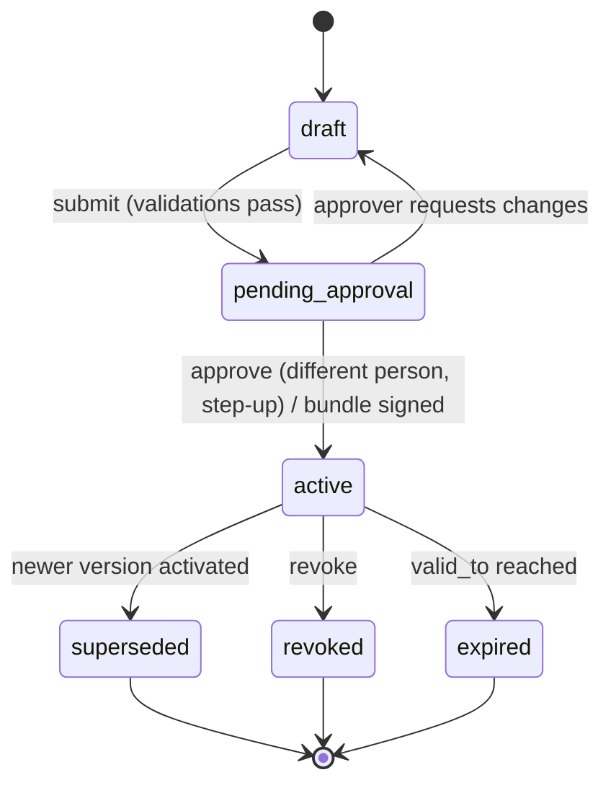
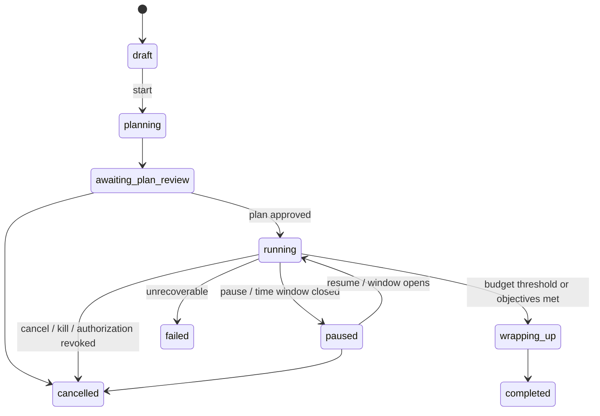
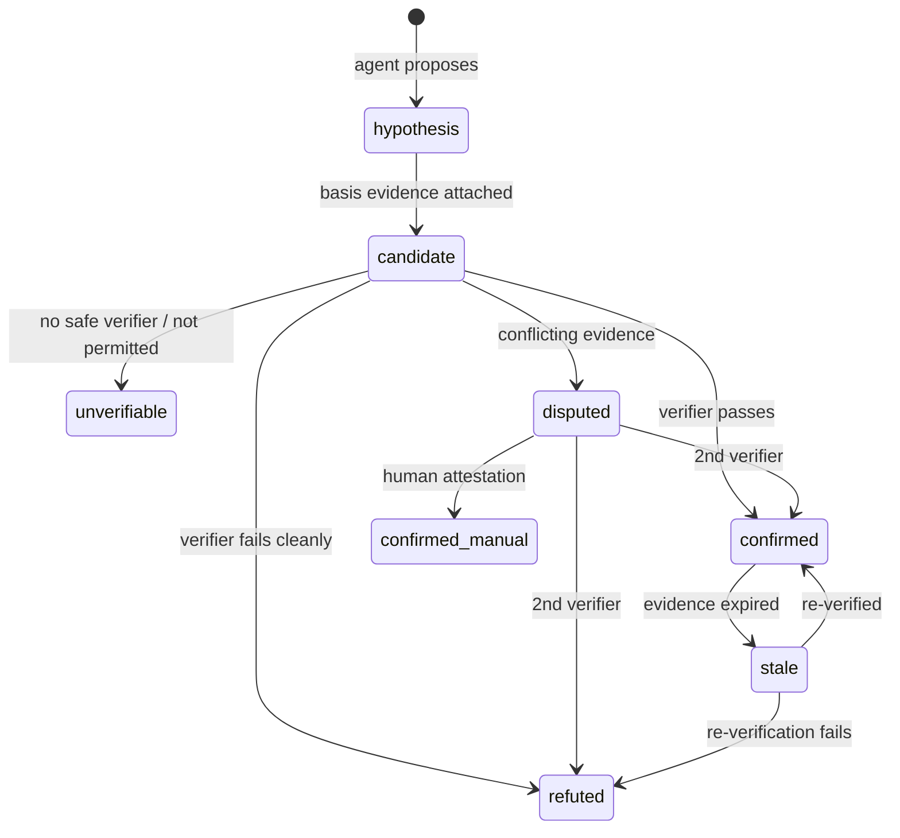
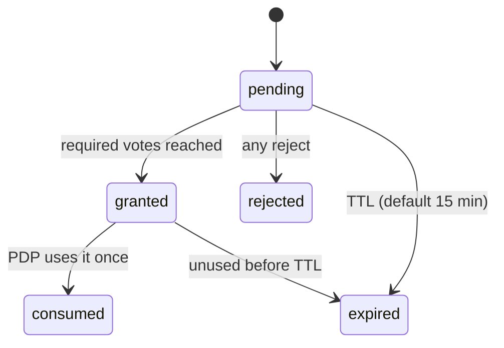

# 9. API specification

Status: `[SPEC]`. External API is REST/JSON under `/v1`, described here and to be published
as OpenAPI 3.1 in `api/openapi/aegis.v1.yaml` (Milestone 1). Internal APIs are gRPC
(`api/proto/…`).

## 9.1 Conventions

- Base URL: `https://<cell>.aegis.example/v1`. Tenant is **never** taken from the URL or body;
  it comes from the token's validated `tid` claim. Resource IDs are UUIDv7.
- Errors: RFC 9457 `application/problem+json` with stable `type` URIs and `reason_code`.
- Pagination: cursor (`?cursor=…&limit≤200`), response `next_cursor`.
- Concurrency: `ETag` on mutable resources; `If-Match` required on PATCH/transition endpoints.
- Idempotency: `Idempotency-Key` header (UUID) required on all POSTs that create or transition;
  stored 24 h per `(tenant, principal, key)` with request hash; replay returns the original
  response; same key + different body → `409 idempotency_key_reuse`.
- Live updates: `GET /v1/streams/assessments/{id}` (SSE), events from 9.7.

## 9.2 Authentication

| Client | Mechanism |
|---|---|
| Browser | OIDC Authorization Code + PKCE via the tenant's IdP; access token (JWT, 10 min, audience `aegis-api`), refresh rotation; session cookie `__Host-` prefixed, `SameSite=Strict` |
| Step-up | For approval votes, authorization-record approval, kill-switch release: `acr` = phishing-resistant MFA and `auth_time` ≤ 5 min, else `401 step_up_required` with `WWW-Authenticate: …acr_values=…` |
| API clients / CI | OAuth client credentials with private_key_jwt; scoped tokens; cannot hold approver roles |
| Services | mTLS SPIFFE IDs (`spiffe://aegis/<cell>/<service>`) |

## 9.3 Authorization model

Cedar policies evaluated in each service (embedded library) with entities loaded from
`role_bindings`. Principal = user/service; action = `Aegis::Action::"<name>"`; resource carries
`tenant`, `business_unit`, `owner_group`.

Global invariant policies (forbid, cannot be overridden by tenant policies):

```cedar
// Never cross tenants
forbid (principal, action, resource) unless { principal.tenant == resource.tenant };
// Two-person rule on authorization records
forbid (principal, action == Aegis::Action::"authorization.approve", resource)
  when { resource.created_by == principal };
// Service principals cannot vote on approvals
forbid (principal is Aegis::Service, action == Aegis::Action::"approval.vote", resource);
// Agents/orchestrator cannot touch scope or policy
forbid (principal is Aegis::Service, action in Aegis::ActionGroup::"governance_write", resource)
  unless { principal.name == "authorization-svc" };
```

## 9.4 Endpoints

| Method & path | Purpose | Cedar action | Notes |
|---|---|---|---|
| `GET /me` | Current user, tenant, roles | — | |
| `POST /assets` | Register asset root | `asset.create` | Starts ownership challenge |
| `POST /assets/{id}/ownership-proofs` | Begin/complete proof | `asset.verify` | Methods per 08 |
| `GET /assets` / `GET /assets/{id}` | Inventory | `asset.read` | Filters: kind, scope_state, tag |
| `POST /authorizations` | Draft authorization record | `authorization.create` | |
| `PUT /authorizations/{id}/scope-items` | Edit draft scope | `authorization.edit` | Only in `draft` |
| `POST /authorizations/{id}:submit` | → `pending_approval` | `authorization.submit` | Validates all includes are verified assets |
| `POST /authorizations/{id}:approve` | Activate (2nd person, step-up) | `authorization.approve` | Compiles + signs bundle |
| `POST /authorizations/{id}:revoke` | Revoke | `authorization.revoke` | Immediate PDP deny for its assessments |
| `POST /authorizations/{id}:simulate` | Policy simulation for a hypothetical action | `authorization.read` | Returns PDP decision + reasons |
| `POST /assessments` | Create | `assessment.create` | Budgets ≤ authorization budgets |
| `POST /assessments/{id}:start` | Start planning | `assessment.run` | |
| `GET /assessments/{id}/plan` | Proposed plan with PDP screening | `assessment.read` | |
| `POST /assessments/{id}/plan:approve` | Approve (optionally edited) plan | `assessment.run` | `If-Match` plan ETag |
| `POST /assessments/{id}:pause` / `:resume` / `:cancel` | Control | `assessment.run` | |
| `GET /assessments/{id}/tasks` | Tasks with states | `assessment.read` | |
| `GET /assessments/{id}/timeline` | Execution events | `assessment.read` | |
| `GET /approvals?state=pending` | My approval queue | `approval.read` | |
| `POST /approvals/{id}/votes` | Grant/reject (step-up) | `approval.vote` | Must not be the requester of the assessment if policy says so |
| `GET /findings` / `GET /findings/{id}` | Findings | `finding.read` | Filter by verification_state, severity, asset |
| `PATCH /findings/{id}` | Lifecycle (owner, accepted_risk w/ expiry, false_positive w/ reason) | `finding.triage` | Cannot set `confirmed` |
| `POST /findings/{id}:reverify` | Schedule re-verification | `finding.reverify` | Runs via PDP like any action |
| `GET /evidence/{id}` | Evidence metadata | `evidence.read` | |
| `GET /evidence/{id}/content` | Redacted content | `evidence.read_content` | `raw_restricted` needs `evidence.read_raw` + reason; audited |
| `GET /graph/query` | Typed graph templates (07 §7.10) | `graph.read` | No free-form queries |
| `GET/POST /remediations…` | Remediation tracking | `remediation.*` | |
| `POST /reports` | Generate report | `report.create` | Async; returns job |
| `GET /audit/events` / `GET /audit/verify?from=&to=` | Audit read / chain verification | `audit.read` | |
| `POST /kill` | Tenant kill switch (`scope`: tenant/assessment) | `governance.kill` | Engaging needs any `governance.kill` holder; **releasing** needs two people + step-up |
| `GET /usage` | Model and compute spend | `usage.read` | |

## 9.5 Example: create an authorization record

```http
POST /v1/authorizations
Authorization: Bearer eyJ...
Idempotency-Key: 0192f0b8-6b1c-7c1e-9b0e-6a7c2f3e9d10
Content-Type: application/json

{
  "mode": "B",
  "capability_ceiling": "C4",
  "enabled_flags": [],
  "valid_from": "2026-12-01T00:00:00Z",
  "valid_to":   "2026-12-15T00:00:00Z",
  "time_windows": [{"tz":"America/New_York","days":["mon","tue","wed","thu","fri"],"from":"09:00","to":"18:00"}],
  "rate_limits": {"http": {"rps": 5, "burst": 10, "concurrency": 2}, "tcp_connect": {"rps": 20, "concurrency": 4}},
  "budgets": {"max_model_cost_usd": 250, "max_sandbox_seconds": 36000, "max_tokens": 40000000},
  "contacts": [{"name":"SOC on-call","channel":"pagerduty","ref":"PXXXX"}],
  "scope_items": [
    {"effect":"include","asset_id":"0192f0a1-...","pattern_kind":"subdomains_of","pattern":"shop.example.com"},
    {"effect":"include","asset_id":"0192f0a2-...","pattern_kind":"cloud_account","pattern":"aws:123456789012"},
    {"effect":"exclude","pattern_kind":"exact_host","pattern":"payments.shop.example.com"}
  ]
}
```

```http
HTTP/1.1 201 Created
ETag: "v1-3f9a"
Location: /v1/authorizations/0192f0b9-...

{
  "id": "0192f0b9-...",
  "lineage_id": "0192f0b9-...",
  "version": 1,
  "state": "draft",
  "content_hash": "sha256:4c1d...",
  "warnings": [
    {"reason_code":"scope.include_has_unverified_children","detail":"subdomains_of shop.example.com: ownership verified for apex only; subdomains inherit"}
  ]
}
```

## 9.6 Example: approval vote (step-up)

```http
POST /v1/approvals/0192f1c0-.../votes
Authorization: Bearer <token with acr=phr, auth_time within 5 min>
Idempotency-Key: 0192f1c1-...
If-Match: "a1"

{ "vote": "grant", "action_hash": "sha256:9e7c...", "comment": "Replica env registered in AUTH-0192f0b9 v2" }
```

The client must echo the `action_hash` shown in the UI; a mismatch returns
`409 approval.action_hash_mismatch` (protects against approving a different action than displayed).

## 9.7 Event schemas

Envelope (CloudEvents 1.0 compatible), published to NATS `t.<tenant>.<type>` and SSE:

```json
{
  "specversion": "1.0",
  "id": "0192f1d2-...",
  "source": "aegis/<cell>/orchestrator",
  "type": "aegis.task.state_changed.v1",
  "time": "2026-12-01T14:03:22.123Z",
  "tenantid": "0192f000-...",
  "assessmentid": "0192f0c0-...",
  "seq": 1842,
  "data": { "task_id": "0192f1d0-...", "from": "dispatched", "to": "running", "attempt": 1 }
}
```

| Type | Data fields |
|---|---|
| `aegis.assessment.state_changed.v1` | from, to, cause |
| `aegis.task.state_changed.v1` | task_id, from, to, attempt, reason_code? |
| `aegis.pdp.decision.v1` | action_id, outcome, reasons[], bundle_version |
| `aegis.approval.requested.v1` / `.decided.v1` | approval_id, action_hash, risk_summary / outcome |
| `aegis.execution.started.v1` / `.finished.v1` | action_id, tool, targets[], exit_code, duration_ms, evidence_ids[] |
| `aegis.finding.updated.v1` | finding_id, verification_state, lifecycle, severity |
| `aegis.budget.threshold.v1` | dimension, used, limit, pct |
| `aegis.kill.engaged.v1` / `.released.v1` | scope, by |
| `aegis.model.usage.v1` | role, model_id, tokens, cost_micro_usd, outcome |

Consumers must tolerate unknown fields and use `seq` for ordering and gap detection.

## 9.8 Agent message contracts

```jsonc
// AgentInvocation (workflow → agent runtime), Temporal activity input
{
  "invocation_id": "uuid",            // idempotency key for the activity
  "tenant_id": "uuid",
  "assessment_id": "uuid",
  "task_id": "uuid",
  "role": "vuln_analysis",
  "agent_version": 7,
  "model_policy": {"tier": "M", "max_output_tokens": 4000, "allowed_providers": ["provider-a","self-hosted"]},
  "budget": {"max_tokens": 60000, "max_cost_micro_usd": 400000},
  "context": [                        // assembled by code; each item labelled
    {"ref":"node:0192...","trust":"verified","kind":"asset_summary","content":{...}},
    {"ref":"obs:0192...","trust":"untrusted","kind":"tool_observation","content":{"untrusted_text":"<<<UNTRUSTED nonce=8f2a>>>...<<<END 8f2a>>>"}}
  ],
  "catalogue_view": ["tool:tls-scan@2.3.1","tool:http-headers@1.4.0"],
  "output_schema_ref": "schemas/agent/vuln_analysis.result.v3.json"
}

// AgentResult (agent → workflow)
{
  "invocation_id": "uuid",
  "status": "ok",                     // ok | refused | budget_exhausted | error
  "hypotheses": [{
    "class": "weak:tls-legacy-protocol",
    "affected_ref": "node:0192...",
    "basis_refs": ["obs:0192..."],    // must be refs present in context
    "suggested_verifier": "verifier:tls-protocol-support@1",
    "model_confidence": 0.74,
    "rationale": {"untrusted_text": "Server negotiated TLS 1.0 in handshake observation..."}
  }],
  "proposed_steps": [{"tool_ref":"tool:tls-scan@2.3.1","params":{"host_ref":"node:0192...","port":443},"why":{"untrusted_text":"..."}}],
  "usage": {"input_tokens": 8123, "output_tokens": 611, "model_id": "…"}
}
```

Validation (orchestrator side): schema; every `*_ref` resolves to an object in the invocation's
context or catalogue view; no literal hostnames/IPs/URLs are accepted in `params` (targets must be
`*_ref`s, so a model cannot invent a target); size limits; `rationale` never interpreted.

## 9.9 Internal gRPC (excerpt)

```protobuf
service PolicyDecision {
  rpc Decide(ActionRequest) returns (Decision);
  rpc Screen(ScreenRequest) returns (ScreenResponse);   // batch, no tokens issued
}
message ActionRequest {
  string action_id = 1;  string tenant_id = 2;  string assessment_id = 3;  string task_id = 4;
  string tool_ref = 5;   bytes canonical_params = 6;   repeated Target targets = 7;
  uint32 attempt = 8;    optional string approval_id = 9;  uint64 bundle_version = 10;
  Estimate estimate = 11; // requests, sandbox_seconds, tokens
}
message Decision {
  enum Outcome { DENY = 0; ALLOW = 1; NEEDS_APPROVAL = 2; }  // zero value is DENY
  Outcome outcome = 1; repeated string reasons = 2; bytes action_hash = 3;
  DecisionToken token = 4;   // present iff ALLOW
}
message DecisionToken { bytes payload = 1; bytes sig = 2; string key_id = 3; } // payload: CBOR{jti,tenant,action_hash,bundle_version,egress[],exp}

service ExecutionBroker {
  rpc Execute(ExecuteRequest) returns (stream ExecutionUpdate);
  rpc Kill(KillRequest) returns (KillAck);
}
```

## 9.10 Idempotency and retry rules

| Layer | Key | Rule |
|---|---|---|
| Public API POST | `Idempotency-Key` | 24 h replay window; request-hash match required |
| Workflow start | `workflow_id = asmt-<assessment_id>` | Temporal rejects duplicates (`WorkflowIdReusePolicy=RejectDuplicate`) |
| Agent invocation | `invocation_id` | Agent runtime caches result by id for 1 h; retries return cached result |
| PDP decision | `(action_id, attempt)` | Same input → same decision (deterministic); new attempt → new token |
| Execution | `DecisionToken.jti` | Broker marks `token_used_at` atomically (`UPDATE … WHERE token_used_at IS NULL`); second use rejected |
| Tool idempotency class | `I0` read-only, no target effect · `I1` read-only with target-side logging/rate effect · `I2` changes state (Mode A lab only) | Auto-retry: I0 ×3, I1 ×1 after backoff ≥ 30 s, I2 never |
| Graph writes | natural keys / fingerprints | Upserts; replays converge |
| Events | `id` + `seq` | At-least-once delivery; consumers dedup by `id` |

## 9.11 State transition diagrams

### Authorization record


### Assessment


### Finding (verification)


### Approval


## 9.12 Preventing cross-tenant access (summary of layers)

1. Tenant from token only; never from input.
2. Cedar global `forbid` on tenant mismatch, evaluated in every service.
3. PostgreSQL RLS with `FORCE`; app role cannot bypass.
4. IDs are UUIDv7 (unguessable enough to not be the control, but no sequential IDs exposed).
5. Object store per-tenant prefixes + KMS keys + session tags.
6. NATS per-tenant accounts; SSE endpoint re-authorizes on subscribe and per event.
7. Temporal payload encryption with tenant DEK.
8. Caches keyed by tenant; Model Gateway semantic cache per tenant only.
9. Automated cross-tenant test suite: for every endpoint, tenant B's token against tenant A's
   resource IDs must return 404 (not 403, to avoid existence oracles) — `T-TENANT-API-*`.
