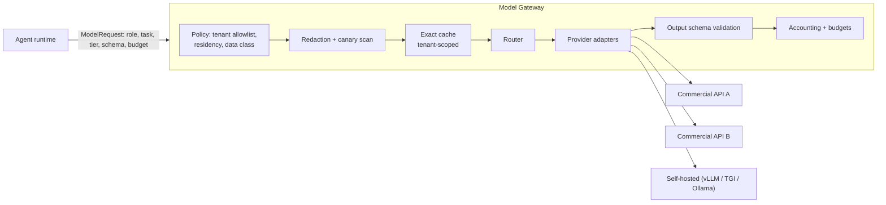

# 11. AI model orchestration design

Status: `[SPEC]` for gateway, registry, accounting, caching, refusal handling and
reproducibility; `[CONCEPT]` for routing thresholds and confidence calibration (need benchmark
data); `[RESEARCH]` for reliable confidence estimation of open-ended security reasoning.

## 11.1 Separation of four kinds of content

The platform must never confuse these. Each has a distinct type, storage location and UI style.

| Kind | Example | Type tag | Can it trigger action? | Can it be evidence? | UI treatment |
|---|---|---|---|---|---|
| **Reasoning** | "TLS 1.0 plus old OpenSSL banner suggests…" | `model_generated` | Only via a schema-valid proposal that the PDP evaluates | No | Italic, "AI reasoning" label, collapsible |
| **Tool execution** | `tls-scan` ran with params X at time T | `ExecutionEvent` | It *is* an action (already authorized) | Its raw output is evidence | Timeline entry with decision link |
| **Verified observation** | Verifier confirmed TLS 1.0 accepted twice, 60 s apart | `verified` | Feeds risk and planning | Yes | Solid badge "Verified", evidence links |
| **Unverified hypothesis** | "Possible CVE-XXXX on host Y" | `model_generated` / status `hypothesis`/`candidate` | Can propose a verification step | No | Dashed outline, "Hypothesis" badge, confidence shown as range |

Enforcement: these are different tables/fields (`graph_nodes.trust_class`, `findings.verification_state`,
`execution_events`). Model text only ever lands in `*_text` fields typed `untrusted_text`/
`model_generated`; code paths that compute risk, coverage or verification refuse those types at
compile time (Go type `ModelText` has no conversion to `Evidence`).

## 11.2 Model Gateway



### 11.2.1 Provider abstraction

```go
type Provider interface {
    ID() string
    Complete(ctx context.Context, req CompletionRequest) (CompletionResponse, error)
    CountTokens(req CompletionRequest) (int, error)          // local tokenizer or provider endpoint
}
type CompletionRequest struct {
    ModelID        string
    System         string            // static role prompt (content-addressed)
    Messages       []Message         // with per-part trust labels preserved for logging
    Tools          []ToolSchema      // ONLY "emit_result"-style schemas; no executable tools (see 11.3)
    ResponseSchema *jsonschema.Schema
    MaxOutputTokens int
    Temperature    float32           // default 0 for classification/extraction, ≤0.3 for planning
    Seed           *int64            // where supported
    Metadata       map[string]string // tenant, task, invocation ids
}
```

Adapters normalize: structured output / tool-call formats, stop reasons (incl. **refusal**),
token usage incl. cached tokens, rate-limit headers, error classes (`retryable`, `capacity`,
`auth`, `refusal`, `invalid_request`, `content_policy`).

### 11.2.2 Model capability registry

```yaml
# config/models/registry.yaml (signed config; prices are inputs, versioned separately)
- id: provider-a/large-2026-09
  provider: provider-a
  tier: L
  context_window: 200000
  max_output: 32000
  structured_output: native_json_schema
  tool_calling: true
  data_retention: zero_retention_endpoint
  regions: [us, eu]
  eval_scores:                      # from OUR benchmark runs only; empty until measured
    planning_v1: null
    triage_v1: null
  price_table: prices/2026-11.yaml
  allowed_data_classes: [D0, D1, D2]
- id: selfhosted/small-instruct
  provider: selfhosted
  tier: S
  context_window: 32000
  structured_output: grammar_constrained
  regions: [customer-vpc]
  allowed_data_classes: [D0, D1, D2]
```

No model is "recommended" in this document by name: model fitness must come from the
benchmark ([14](14-testing-benchmarking.md)), and the market changes faster than this design.

## 11.3 Structured tool calling, without tools

Agents use the provider's tool-calling / structured-output feature **only to emit typed
results** (`emit_hypotheses`, `emit_plan`, …). No provider-side tool causes side effects. The
"tools" a model sees in its catalogue view are descriptions of what it may *propose*; execution
is the orchestrator's decision after PDP evaluation. This removes the "model calls shell"
pattern that ARTEX is built on `[CODE]`.

## 11.4 Task-specific routing

| Task class | Examples | Default tier | Escalation rule |
|---|---|---|---|
| Extraction / normalization | Parse banner into product+version; map scanner rule → CWE | S | Schema failure twice → M |
| Classification / triage | Is this SAST result likely a false positive given context? | S | Low calibrated confidence (< τ_S) → M |
| Summarization (non-evidence) | Finding description, report prose | S/M | — |
| Correlation | Combine version + config + exposure into hypothesis | M | Conflicting signals or > N inputs → L |
| Planning | Initial assessment DAG | L | — |
| Re-planning | Next steps given new observations | M | Stagnation detector (no coverage gain in k rounds) → L once |
| Remediation | Fix steps + reverify plan | M | — |
| Verification explanation | Explain a verifier verdict | S | — |

Router algorithm:

```python
def route(req: ModelRequest, policy: TenantModelPolicy, registry: Registry, health: Health) -> Route:
    candidates = [m for m in registry.models
                  if m.tier >= req.min_tier
                  and req.data_class in m.allowed_data_classes
                  and policy.allows(m.provider, m.region)
                  and m.context_window >= req.estimated_tokens * 1.2
                  and (not req.schema or m.structured_output != "none")]
    if not candidates:
        return Route.park("no_eligible_model")          # never silently relax policy
    candidates.sort(key=lambda m: (m.tier != req.preferred_tier,
                                   -m.eval_score(req.task_class) if m.eval_score(req.task_class) else 0,
                                   m.expected_cost(req),
                                   health.error_rate(m)))
    primary = next((m for m in candidates if health.available(m)), None)
    return Route(primary, fallbacks=[m for m in candidates if m is not primary and m.tier == primary.tier][:2])
```

### 11.4.1 Refusals and safety restrictions

**A refusal is terminal for that request.** The gateway records `outcome=refused`, returns
`status: refused` to the orchestrator, and the task becomes `failed_terminal` with reason
`model.refused`. The router does **not** retry on another provider or a less restrictive model,
and prompts are not rephrased to get around the refusal. Rationale: Check Point documented
operators switching models specifically to avoid guardrails `[DOC]`; AEGIS-X must not offer that
path. Fallback routing is allowed only for availability errors (`retryable`, `capacity`,
`timeout`), never for `refusal` or `content_policy`. Test `T-MG-REFUSAL-1`.

Model switching also cannot affect platform controls: models have no authority (11.3, 05), so a
"more permissive" model can at most propose more, and the PDP decides.

## 11.5 Context-window management

1. **Budgeted assembly**: the context assembler gets a token budget per invocation (from role
   config), fills it by priority: task instruction → required refs → verified facts → recent
   observations → summaries, and truncates with explicit `[omitted: N items, query ref …]` markers.
2. **No unbounded transcripts**: each invocation is single-turn over an assembled context;
   continuity comes from the graph and the task record, not from a growing chat history. This
   avoids the token blow-up observed in ARTEX-driven intrusions (~1.4 B input tokens in one
   intrusion's planning) `[DOC]`.
3. **Prompt caching**: static system prompts and catalogue views are placed first to benefit from
   provider prefix caching; cache-read tokens are accounted separately.

## 11.6 Persistent task memory

| Memory | Store | Writer | Trust |
|---|---|---|---|
| Task record (state, attempts, decisions) | PG | Orchestrator | platform |
| Facts and findings | SKG | Graph svc / Verification | per trust class |
| What was tested | EHG | Broker / Orchestrator | platform |
| Summaries ("digest of 40 observations on host X") | `summaries` table, linked to source refs | Agent (S tier) | `model_generated`, never evidence, regenerated on source change |
| Lessons across assessments | `lessons` table | **Human-curated only** from agent suggestions | platform after approval |

ARTEX lets model-written compaction digests and lessons accumulate `[CODE]`; AEGIS-X keeps them
but marks them, links them to sources, and requires human curation for cross-assessment lessons
(defends against memory poisoning, OWASP agent risk list `[DOC]`).

## 11.7 Retrieval-augmented generation

- **Corpora**: (a) public: CVE/NVD, OSV, CISA KEV, vendor advisories, CWE, CIS benchmarks,
  ATT&CK (for detection mapping); (b) tenant: their findings history, asset docs they upload.
- **Index**: pgvector in PG (per-tenant partitions for tenant corpora; shared index for public).
  Hybrid retrieval (BM25 via PG full text + vector), re-ranked by an S-tier model or cross-encoder.
- **Rules**: retrieved public content is labelled `untrusted` (advisories can be wrong or
  poisoned); tenant content never crosses tenants; each retrieved chunk carries its source URL
  and fetch date, shown in UI when used in reasoning.

## 11.8 Result caching

- **Exact cache**: key = `sha256(tenant ‖ model_id ‖ system_prompt_hash ‖ canonical(messages) ‖
  schema_hash ‖ params)`; TTL 7 d; used for deterministic tasks (temperature 0 extraction/triage).
- **No cross-tenant cache**, no semantic cache for planning (staleness risk) in MVP.
- **Execution reuse** (tool results) is handled by the EHG (07 §7.9), which saves far more than
  model caching.

## 11.9 Confidence estimation (`[CONCEPT]` → `[RESEARCH]` for open-ended reasoning)

1. Models output `model_confidence` in schema, but it is **not trusted raw**.
2. For classification tasks, calibrate with isotonic regression per (model, task_class) on
   labelled benchmark data; report Expected Calibration Error (ECE) per release.
3. For S-tier triage, optional self-consistency (n=3 samples) for borderline cases; agreement
   rate becomes part of the calibrated score. Cost-capped.
4. Displayed as a coarse band ("low / medium / high hypothesis confidence"), never as a
   percentage that looks like verification.
5. Confidence never changes verification state; it only affects ordering and whether a
   verifier is scheduled.

## 11.10 Independent result verification

Covered in [05 §5.2 (10)](05-multi-agent-design.md) and [10 §10.8](10-secure-execution.md). In
short: verification is deterministic code over raw evidence; an LLM may *suggest* which verifier
to run, never decide the verdict. For classes without deterministic verifiers, an optional
"second-opinion" model check may annotate (`model_second_opinion: agree|disagree`), but the
finding remains `unverifiable` and is reported as such.

## 11.11 Model failure recovery

| Failure | Handling |
|---|---|
| 429 / capacity | Respect `retry-after`; token-bucket per provider in gateway; then fallback within same tier |
| 5xx / timeout | 3 retries with jittered exponential backoff (1, 4, 16 s); then fallback |
| Schema-invalid output | One repair turn with validator errors; then fail (counted toward hallucination metric) |
| Hallucinated refs (IDs not in context) | Reject; counted; no repair (indicates context confusion) |
| Refusal / content policy | Terminal (11.4.1) |
| Provider outage > 5 min | Circuit open; tasks needing that model's tier park in `waiting_model` if no eligible fallback; operator alert |
| Budget exhausted | Task → wrap-up; no further model calls except S-tier summarization within reserve |

## 11.12 Token and cost accounting

Every call writes a `model_usage` row (08) with tokens (input, cached input, output), cost
computed from a **versioned price table** (input to the cost model, not a claim about provider
prices), latency, outcome, route reason. Budgets are reserved before the call
(`estimated_tokens × price`) and settled after. The gateway refuses calls that would exceed the
task/assessment/tenant budget. Dashboards show cost per assessment, per role, per verified finding.

## 11.13 Reproducible assessment runs

A run is reproducible to the degree providers allow. We record:

- Bundle version, agent definition versions, prompt template hashes, tool manifest digests,
  model IDs (exact snapshot identifiers), sampling params, seeds where supported.
- Every model request/response (encrypted with tenant DEK, stored in object store, retention per
  tenant policy).
- Every tool execution's params and raw outputs.

**Replay modes**: (1) *Exact replay* re-feeds recorded model responses and recorded tool outputs
to the orchestrator and checks that the same decisions/findings result (tests determinism of our
code — required in CI for benchmark scenarios). (2) *Re-run* calls models again; differences are
reported as model nondeterminism metrics, not hidden.
