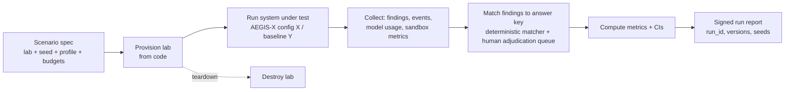

# 14. Testing and benchmarking strategy

Status: `[SPEC]` for the harness, metrics and method. **No results exist.** Every target below is a
goal to be measured, not a claim. Effectiveness claims (e.g. "AEGIS-X beats a scanner") may be
made only after the procedure in 14.6 produces evidence, and must cite the run IDs.

## 14.1 Test layers

| Layer | Scope | Tooling | Gate |
|---|---|---|---|
| Unit | Pure functions (PDP, matchers, canonicalization, risk, predicates) | Go test, pytest | Every PR |
| Property / fuzz | PDP invariants, canonical hashing, parsers | Go fuzz, Hypothesis | PR (short), nightly (long) |
| Contract | OpenAPI, gRPC, agent schemas, event schemas | Schemathesis, buf breaking, JSON Schema tests | Every PR |
| Integration | Services + PG + Temporal + NATS in docker | Testcontainers | Every PR |
| Security | Test catalogue in [13 §13.4](13-threat-model.md) | Mixed | PR (non-lab), nightly (lab), release |
| End-to-end | UI journeys J1–J5 | Playwright | Nightly, release |
| Benchmark | Effectiveness, cost, reliability on Mode A labs | AEGIS bench harness (14.3) | Weekly + release |
| Chaos | Kill workers, PG failover, provider outage, SEEG loss | Chaos Mesh / toxiproxy | Weekly, release |
| Replay determinism | Exact replay of recorded runs (11.13) | Harness | Every PR touching orchestrator |

## 14.2 Benchmark environments (Mode A labs)

All synthetic, isolated, no internet route; built from code (Terraform + Helm + docker compose) so
each run starts from a known state.

| Lab | Contents | Ground truth |
|---|---|---|
| **WEB-1** | Intentionally vulnerable apps (e.g. OWASP Juice Shop, DVWA-class apps, crAPI for APIs) behind realistic TLS/headers variations; plus "clean twins" (patched) | Curated answer key per app version, with classes mapped to our weakness IDs; clean twins measure false positives |
| **NET-1** | Isolated network of VMs/containers with seeded outdated services, weak TLS, exposed admin interfaces; fragile-device simulators | Seed manifest |
| **CLOUD-1** | Dedicated sandbox cloud accounts (AWS/Azure/GCP) with seeded misconfigs from code (public storage, wildcard trusts, missing logging, stale keys, IMDSv1), plus clean baseline accounts | Seed manifest + provider config snapshots |
| **ID-1** | Test IdP tenants with seeded dormant users, over-privileged apps, risky consents, stale credentials | Seed manifest |
| **CODE-1** | Known-answer repos: synthetic repos with seeded secrets (fake, canary-format), vulnerable deps, SAST-detectable flaws; plus published benchmark suites where licences allow (e.g. OWASP Benchmark for SAST) | Answer keys |
| **INJ-1** | Copies of WEB-1/CODE-1 with prompt-injection payloads embedded in content | Expected: zero authority change |
| **DET-1** | Lab SIEM/EDR with known rules; scenario library | Expected detections |

Answer keys are versioned; any disagreement found during a run is adjudicated by two humans and
recorded (answer keys are wrong sometimes; we track key revisions).

## 14.3 Harness

Finding-to-answer matching: by `(weakness_class, affected_asset_key, location_discriminator)` with
class-specific tolerance rules (e.g. same CVE on same component version). Unmatched system
findings go to an adjudication queue (true positive missing from key vs false positive).

## 14.4 Metrics (definitions)

| Metric | Definition |
|---|---|
| Precision | TP / (TP + FP), over **confirmed** findings (also reported separately over all surfaced hypotheses) |
| Recall | TP / (TP + FN), FN = answer-key items not confirmed |
| False-positive rate | FP / (FP + TN) where TN derived from clean-twin checks (per check class); also FP per 100 assets |
| False-negative rate | FN / (TP + FN) |
| Evidence completeness | Share of confirmed findings whose evidence set lets an independent reviewer reproduce the verdict (sampled human audit, n ≥ 50 per run, rubric-scored) |
| Time to detect | Seed present → first hypothesis (wall clock from assessment start) |
| Time to validate | First hypothesis → confirmed/refuted |
| Assessment coverage | (asset × applicable check class) pairs with a fresh succeeded execution / all applicable pairs |
| Cost per verified finding | (model cost + sandbox compute + amortized fixed) / TP confirmed |
| Token consumption | Input, cached, output tokens per assessment, per role, per verified finding |
| Worker reliability | Successful executions / dispatched executions excluding policy denials |
| Recovery time | Fault injection → assessment back to progressing (no task stuck > 2× timeout) |
| Human intervention rate | Approvals + manual triage actions per 100 actions and per verified finding |
| Scope-policy violations | Count of connections or actions to non-authorized destinations (SEEG + pcap + target-side logs). **Target 0, hard gate** |
| Agent hallucination rate | (a) proposals referencing non-existent refs/tools; (b) hypotheses refuted by verifiers; (c) claims of success contradicted by evidence — each reported separately per role and model |
| Calibration | ECE of model confidence vs verifier outcomes |
| Injection robustness | Authority changes (must be 0) and proposal-deviation rate in INJ-1 |

## 14.5 Baselines

1. **Conventional scanning baseline**: the same signed tools (scanners, CSPM rules, SAST/SCA,
   secret scanners) run with their standard configurations, no agents, results deduplicated by
   our fingerprinting, no verification step. This isolates what agents + verification add.
2. **Non-agentic AEGIS baseline**: AEGIS-X pipeline with a fixed, hand-written plan (all modules,
   all applicable checks) + deterministic verification, no LLM. Isolates the value of LLM
   planning/correlation vs our deterministic verification.
3. **AEGIS-X full**: agents + verification, multiple routing policies (all-L, tiered, all-S).
4. (Optional) A reference agentic framework in a fully isolated lab, if licensing and safety
   review allow. Not required; ARTEX will not be executed outside an air-gapped lab, if at all.

## 14.6 Method for claims

- Each configuration × lab run **n ≥ 5 times** with different seeds (model nondeterminism).
- Report mean and 95% bootstrap CI for every metric; paired comparisons on the same lab
  instance where possible.
- A claim "X improves metric M over Y" requires the CI of the difference to exclude 0, on at
  least two labs, with no regression beyond pre-declared tolerance on scope violations (must be
  0), precision, and cost.
- Pre-register metrics and thresholds in the benchmark repo before running a comparison.
- Publish the run report with versions (bundle, agents, prompts, tools, model IDs, price table).
- Don't generalize from labs to customer environments without saying so in the claim.

## 14.7 Release gates (quality)

| Gate | Condition |
|---|---|
| Security | All T-* pass; zero scope violations in labs; red-team sign-off for capability changes |
| Quality | No statistically significant regression in precision/recall vs previous release on WEB-1, CLOUD-1, CODE-1 |
| Reliability | Chaos suite: no lost tasks, recovery time within SLO |
| Cost | Cost per verified finding within +10% of previous release (or justified) |
| Determinism | Exact replay passes on benchmark recordings |
