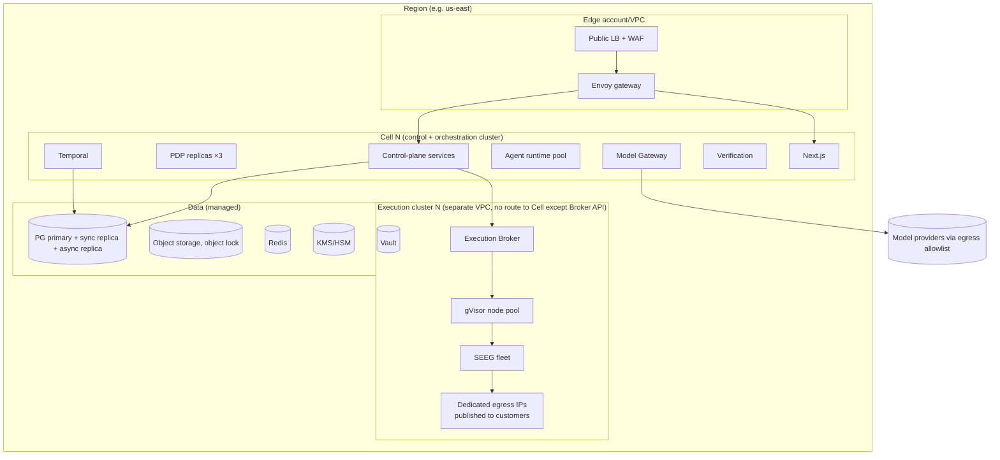

# 15. Infrastructure and deployment plan (incl. technology stack evaluation)

Status: `[SPEC]` for choices and topology. Cost notes are qualitative here; the quantitative
model is in [16](16-reliability-cost-scaling.md). Technology traits are `[GENERAL]` knowledge and
should be re-validated at Milestone 1 kickoff (versions, licences, managed-service availability).

## 15.1 Selection criteria

Correctness and security of the enforcement path first, then operability for a small team,
then cost, then performance. ARTEX's choices (Go, Next.js, PostgreSQL) were evaluated on these
criteria like any other option; matching ARTEX was not a criterion.

## 15.2 Decisions

### Go for control plane, PDP, Broker, SEEG, Model Gateway
- **Why**: memory-safe, simple concurrency, static binaries, strong networking stdlib, mature
  gRPC/OTel/Temporal SDKs, easy to audit. Deterministic Temporal workflows are well supported.
- **Alternatives**: Rust (stronger guarantees, best for SEEG data path; higher hiring/velocity
  cost), Java/Kotlin (mature, heavier runtime), TypeScript (team overlap with UI, weaker for
  network enforcement).
- **Tradeoff**: Rust would be the choice if SEEG throughput becomes the bottleneck; keep SEEG's
  interface narrow so it can be rewritten (`[CONCEPT]`).
- **Failure modes**: GC pauses on SEEG under heavy load (mitigate with pooling, horizontal scale).

### Python for agent runtime and analysis
- **Why**: best ecosystem for LLM SDKs, evaluation tooling, data science for calibration;
  agents are I/O bound, so Python's performance is not a constraint.
- **Alternatives**: all-Go (one language, fewer contracts; thinner LLM ecosystem), TypeScript.
- **Tradeoff**: a second language costs CI and expertise; mitigated because the agent runtime is
  stateless and talks only through Temporal activities and the Model Gateway with JSON Schema
  contracts. Agents do not call providers directly (gateway in Go enforces policy).
- **Failure modes**: dependency sprawl → pinned lockfiles, SBOM, minimal images.

### TypeScript + Next.js (App Router) + React for UI
- **Why**: mainstream, accessible component ecosystem, SSR for dashboards, typed API client
  from OpenAPI.
- **Alternatives**: SvelteKit (lighter), plain React SPA + Vite (simpler deploy, no server
  runtime). Next.js is chosen for SSR of heavy dashboards; if SSR is not needed, a static SPA
  behind the API gateway is acceptable and reduces attack surface (decide in Milestone 5).
- **Failure modes**: server components leaking data across requests → no tenant data in module
  scope; lint rule; tests.

### PostgreSQL (primary store, including the graph)
- **Why**: transactional integrity for authorization/approvals/findings; RLS for tenancy; JSONB +
  GIN for flexible props; recursive CTEs for bounded traversals; pgvector for RAG; one system to
  operate, back up and secure.
- **Alternatives**: CockroachDB/Yugabyte (multi-region, higher cost/complexity), separate
  document store (more systems).
- **Failure modes**: write contention on hot rows (budget ledger design, 08 §8.5); large
  traversals (depth caps, precomputed `REACHABLE_FROM` edges).

### Graph database: **not in MVP**; criteria to add one
- **Why not yet**: our traversals are bounded (≤ 6 hops) and tenant-partitioned; PG handles
  this at the target scale (5,000 assets/assessment; low millions of edges per tenant) based on
  general experience with recursive CTEs (`[GENERAL]`, to be load-tested in Milestone 3).
- **When to add**: if p95 of `paths.exposure` or `identity.effective_permissions` exceeds 2 s
  at target scale after indexing and precomputation, evaluate Neo4j, Memgraph, or Apache AGE
  (PG extension, keeps one system). The Graph svc API is the seam; agents never see the engine.
- **Cost of adding**: another stateful system, separate backups and tenancy enforcement (no RLS
  equivalent in most graph DBs → per-tenant databases or label filters, both weaker).

### Redis (short-lived coordination and caching)
- **Use**: model exact cache, SEEG rate-limit coordination (with local token buckets as the
  authority on each SEEG instance), session revocation lists.
- **Not used for**: queues, locks that matter for correctness (those use PG leases or Temporal).
- **Alternatives**: Valkey (licence-friendly fork), Memcached (no data structures).
- **Failure modes**: Redis loss → caches cold; SEEG falls back to local buckets with
  conservative per-instance share (rate ÷ instances) — fail safe (slower), not open.

### Durable workflow engine: Temporal
- **Why**: durable execution with history, timers (approval TTLs, time windows), signals (kill,
  pause), retries, versioning of workflow code; proven pattern for long-running orchestration.
- **Alternatives**: Restate (lighter, newer), AWS Step Functions (cloud lock-in, payload limits),
  Argo Workflows (batch-oriented), PG-based job queues like River (simpler, but we would
  rebuild timers/signals/replay).
- **Cost/burden**: Temporal cluster (or Temporal Cloud) is a significant operational component;
  managed service reduces burden at a per-action price.
- **Failure modes**: history size growth for long assessments → continue-as-new every N steps;
  non-deterministic workflow code → replay tests in CI.

### Event bus: NATS JetStream (via transactional outbox)
- **Why**: lightweight, multi-tenant accounts, subject-based routing for UI fan-out.
- **Alternatives**: Kafka (heavier, better for very high volume analytics), Redis Streams,
  PG LISTEN/NOTIFY (fine for Mode A).
- **Failure modes**: bus loss → outbox retains events; UI falls back to polling.

### Containerized workers on Kubernetes
- **Why**: per-action pods, RuntimeClass (gVisor/Kata), NetworkPolicy, ResourceQuota, admission
  control, autoscaling. Separate execution cluster (or at least node pool + namespace isolation).
- **Alternatives**: Nomad (simpler; weaker ecosystem for policy), Firecracker orchestrators
  directly (stronger isolation, more custom work), serverless containers (cold starts, egress
  control limits).
- **When not**: Mode A single workstation uses docker compose with gVisor `runsc` runtime where
  available; documented reduced-isolation warning otherwise.
- **Failure modes**: K8s API saturation from pod churn → batch tools into short-lived "action
  pods" with pre-warmed pools per tool image (`[CONCEPT]`), API priority and fairness.

### OpenTelemetry
- **Use**: traces across API → workflow → PDP → Broker → SEEG with `tenant_id`,
  `assessment_id`, `action_id` attributes (never secrets, never evidence bodies); metrics;
  logs correlated by trace ID. Backend: Grafana stack (Tempo/Mimir/Loki) or vendor.
- **Note**: telemetry is not audit. Audit is the hash chain; telemetry can be sampled.

### Identity: OIDC + RBAC/ABAC with Cedar
- **Why Cedar**: analyzable policy language designed for authorization, deny-overrides,
  embeddable in Go via its Go implementation (`[GENERAL]`; verify maturity at kickoff).
- **Alternatives**: OPA/Rego (very flexible, general-purpose, harder to analyze), OpenFGA/SpiceDB
  (relationship-based; good if sharing models get complex), hand-written checks (error-prone).
- **Failure modes**: policy bugs → policy unit tests + Cedar validation against schema in CI.

### Secrets: HashiCorp Vault / OpenBao or cloud secret managers + KMS
- **Use**: dynamic, short-lived credentials (cloud STS via Vault secrets engines or direct STS
  with session policies), transit encryption for tenant DEKs, PKI for SEEG ephemeral CAs.
  Signing keys (bundles, decision tokens, tool manifests) in cloud KMS/HSM, non-exportable.
- **Alternatives**: cloud-native only (AWS Secrets Manager + KMS) for SaaS single-cloud; Vault
  for customer-hosted/multi-cloud.
- **Failure modes**: Vault sealed/unavailable → no new executions needing creds (fail closed).

### Sandbox runtime: gVisor (MVP), Kata/Firecracker (enterprise tier)
- gVisor: user-space kernel, good syscall attack-surface reduction, some compatibility gaps and
  network overhead. Kata/Firecracker: VM-grade isolation, more infra work, higher per-pod overhead.

### Egress enforcement: custom SEEG + CNI policy
- Off-the-shelf FQDN policies (e.g. Cilium DNS-aware policies) are defense in depth but do not
  provide per-action, per-target, rate-limited, credential-injecting, evidence-capturing
  enforcement; hence a purpose-built gateway (`[SPEC]`), with CNI policy as the outer wall.

## 15.3 Production topology (Mode B SaaS, one region)

- Execution cluster has **no network path** to the control cluster except the Broker's inbound
  gRPC from orchestrator identities, and outbound evidence writes to object storage via a
  VPC endpoint with a write-only role.
- Agent runtime pods egress only to Model Gateway and Temporal (NetworkPolicy).
- Model Gateway egress only to allowlisted provider endpoints.

## 15.4 Per-mode deployment

| Mode | Packaging | Notes |
|---|---|---|
| A | `docker compose` (dev laptop) and `kind` + Helm (lab server) | Lab targets in an internal network with no default route; local model server optional; seeded labs from `labs/` Terraform/Helm |
| B (SaaS) | Helm charts per cell + Terraform for cloud infra | Multi-tenant cells; enterprise tenants can get dedicated execution node pools or dedicated cells |
| B (customer-hosted) | Same Helm charts in customer's K8s; air-gapped variant with self-hosted models | Customer runs Vault/KMS; we ship signed images + tool catalogue bundles |
| C | Same as B with execution reduced to API-reading workers; schedules | Lower cost profile |

## 15.5 CI/CD and supply chain

- Monorepo CI: lint, type check, unit, contract, integration, security tests (non-lab), SBOM
  (Syft), vuln scan (Grype/Trivy), secret scan, licence check, image signing (cosign keyless or
  KMS key), SLSA provenance attestation.
- Deploy via GitOps (Argo CD/Flux) with admission policies requiring signed images.
- Tool catalogue releases are a separate pipeline with mandatory human review + threat review record.
- Database migrations run as a pre-deploy job with `aegis_migrator` role; forward-only;
  expand/contract pattern for zero-downtime.

## 15.6 Observability and operations

- Golden signals per service; SLO burn-rate alerts ([16](16-reliability-cost-scaling.md)).
- Security monitoring of the platform itself: SEEG deny spikes, PDP deny spikes per tenant,
  approval request rates, unusual target diversity (abuse), audit chain verification job.
- Runbooks: kill switch, provider outage, PG failover, SEEG degradation, key rotation, tenant offboarding (crypto-shred tenant DEK).

## 15.7 Backup and disaster recovery

| Component | Backup | RPO | RTO (target) |
|---|---|---|---|
| PG | PITR (WAL archiving) + daily snapshots, cross-region copy | ≤ 5 min | ≤ 1 h |
| Temporal | Uses PG; same | ≤ 5 min | ≤ 1 h (running workflows resume) |
| Object storage | Versioning + cross-region replication; object lock | ≤ 15 min | ≤ 1 h |
| Audit anchors | WORM in second region | 1 h (anchoring interval) | n/a |
| Vault/KMS | Managed/HA, key backup per provider guidance | — | ≤ 1 h |

DR principle: after a restore, all in-flight decision tokens are invalid (key epoch bump), so
nothing resumes execution without fresh PDP decisions.
