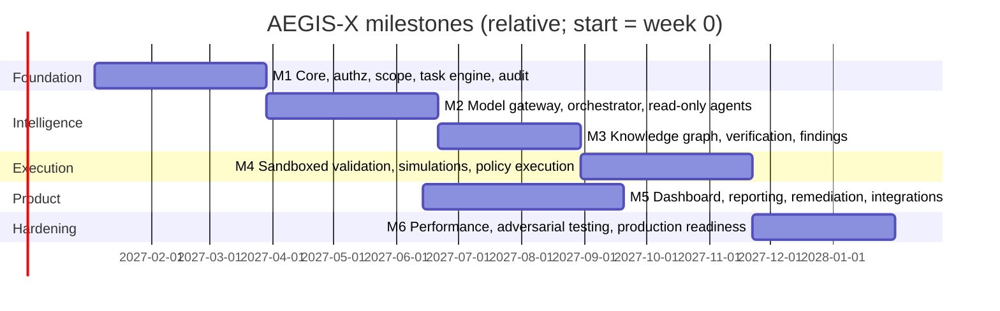

# 17. Phased implementation roadmap

Status: `[SPEC]`. Effort estimates are planning estimates in engineer-weeks (ew) for a team of
roughly 8–10 engineers (3 Go backend, 2 Python/AI, 1 platform/SRE, 1 security engineer, 2
frontend, part-time design and PM). They carry ±40% uncertainty and should be re-estimated after
Milestone 1.

(Dates are placeholders to show sequencing; M5 overlaps M3–M4 because UI work can start on
stable APIs.)

Total estimated effort is ~580–700 ew, about 14–16 months for a fully staffed team of 9–10.
With a smaller team, keep the order and stretch the timeline; do not drop security gates to
recover schedule.

## Milestone 1 — Core architecture, authentication, scope enforcement, task engine, audit

- **Deliverables**
  - Monorepo skeleton ([18](18-repository-structure.md)), CI (lint, types, tests, SBOM, signing), docker compose dev env.
  - Identity & Tenant svc: OIDC login, memberships, roles, Cedar authorization with global forbids.
  - PG schema for tenancy, assets, ownership proofs, authorization records, scope items, policy bundles, assessments, tasks, action requests, decisions, approvals, audit; RLS forced on all tenant tables.
  - Authorization & Scope svc: draft → submit → two-person approve → compile + sign bundle (KMS or local dev key).
  - PDP library + service with golden tests and fuzzing; decision tokens.
  - Approval svc with action-hash binding and step-up check.
  - Temporal deployment; skeleton AssessmentWorkflow (no LLM) that walks a fixed synthetic plan, calls PDP, and records decisions.
  - Execution Broker stub that verifies tokens and runs a **no-network** echo tool (C0) in gVisor.
  - Audit svc: hash chain, verification endpoint, anchoring job (local WORM emulation in dev).
  - Read-only operator UI: assessments list, authorization viewer, audit log.
  - Health checks, structured logs, OTel traces.
- **Dependencies**: cloud account/KMS for staging; IdP for dev (Keycloak in compose).
- **Effort**: ~90–110 ew.
- **Acceptance criteria**: T-AUTH-*, T-BUNDLE-*, T-PDP-GOLDEN/FUZZ, T-PDP-3..6, T-EXEC-1..3, T-APPR-*, T-AUDIT-*, T-TENANT-API-* (for M1 endpoints), T-TENANT-DB-* all pass in CI; a synthetic assessment runs end to end with every action audited; no live network tools exist in the build.
- **Security review gate**: architecture + threat model review of PDP, token design, RLS, Cedar policies; key management review. Exit blocked on any High finding.

## Milestone 2 — Model abstraction, orchestrator, initial agents, read-only integrations

- **Deliverables**
  - Model Gateway: provider adapters (one commercial API, one self-hosted OpenAI-compatible), capability registry, routing, refusal handling, redaction, accounting, budgets, exact cache.
  - Agent runtime (Python) with Planning, Discovery, Cloud, Code roles; JSON Schema contracts; context assembler.
  - Orchestrator workflow with plan review, PDP screening, scheduling, budgets, kill/pause/cancel.
  - SEEG v1 (HTTP/HTTPS CONNECT + DNS resolver + allowlist + rate limit + capture) and sandboxed C1–C3 tools: passive DNS/CT, http-probe, tls-scan.
  - Read-only connectors (C2): AWS/Azure/GCP config readers, one SCM (GitHub app), secret-scan + SCA in sandbox.
  - Mode A labs WEB-1 (subset), CLOUD-1 (one provider), CODE-1; bench harness v1.
- **Dependencies**: M1; provider contracts and data-processing agreements; lab cloud accounts.
- **Effort**: ~110–130 ew.
- **Acceptance criteria**: T-NET-* (lab), T-INJ-1..10, T-CRED-1..4, T-MG-*, T-CLOUD-RO pass; first benchmark run report published (baselines 1 and 2 vs agents) with CIs — whatever the result; zero scope violations.
- **Security review gate**: SEEG design review and red-team scope-escape exercise in lab; model data-flow/privacy review (DPIA).

## Milestone 3 — Knowledge graph, evidence verification, findings management

- **Deliverables**
  - Graph svc: SKG + EHG schema, typed query templates, provenance, dedup, bitemporal versioning, freshness, conflict resolution.
  - Verification svc with verifier registry and CEL predicates; first 30 verifiers across web/TLS/headers/cloud/code classes.
  - Findings svc: lifecycle, fingerprints, groups, risk scoring v1, evidence linking with hashes; DB trigger enforcing confirmed ⇒ verification evidence by verifier.
  - Vulnerability Analysis and Identity agents; identity readers (Entra/Okta) and effective-permissions engine (documented subset).
  - Execution reuse via EHG fingerprints.
- **Dependencies**: M2.
- **Effort**: ~90–110 ew.
- **Acceptance criteria**: T-VER-*, T-EVID-*, T-DUP-*, T-CTX-*, T-INJ-PROP-1 pass; graph query p95 < 2 s at 5k-asset synthetic scale; benchmark shows hallucination rate of *confirmed* findings measured (target: 0 refuted-on-audit in sample) and precision reported vs baselines.
- **Security review gate**: data model and tenancy review of graph; evidence integrity review.

## Milestone 4 — Sandboxed validation, isolated simulations, policy-controlled execution

- **Deliverables**
  - Hardened execution: signed manifests + admission policy, per-tool resource limits, pre-warmed pools, credential injection in SEEG, STS session policies, cleanup sweeper, kill switch end-to-end (out-of-band to Broker/SEEG).
  - Validation agent + C4 safe checks; C5 authenticated read-only testing with test accounts (approval-gated).
  - C6 replica verification flow (Mode A first; Mode B only for registered replicas).
  - Defensive Simulation agent + scenario library v1 + DET-1 lab (C7).
  - Tool catalogue review process and first external tool reviews.
- **Dependencies**: M3; legal review of C5–C7 terms.
- **Effort**: ~110–130 ew.
- **Acceptance criteria**: T-SBX-*, T-KILL-*, T-RATE-*, T-SUPPLY-*, T-OUT-* pass; kill switch SLOs met in lab; zero scope violations under full INJ-1 corpus; red-team cannot reach control plane from sandbox.
- **Security review gate**: **mandatory external penetration test** of execution plane; capability-class review board sign-off before enabling C5+ for any tenant.

## Milestone 5 — Enterprise dashboard, reporting, remediation workflows, integrations

- **Deliverables**
  - All 10 views ([12](12-ui-specifications.md)) at production quality; WCAG 2.2 AA audit.
  - Reporting Studio with templates and manifests; AI paragraphs require acceptance.
  - Remediation Center with Jira/ServiceNow/GitHub Issues two-way sync; reverify flows.
  - SCIM provisioning; notification channels; SIEM export of audit events.
- **Dependencies**: M3 APIs (UI starts against mocks during M3).
- **Effort**: ~100–120 ew.
- **Acceptance criteria**: journeys J1–J5 automated in Playwright; accessibility audit passed; T-UI-XSS-1 pass; usability test with ≥ 5 target-persona users with documented findings addressed.
- **Security review gate**: web app security review (CSP, Trusted Types, auth flows), integration credential handling review.

## Milestone 6 — Performance, adversarial testing, reliability hardening, production readiness

- **Deliverables**
  - Load test to scale target (16.1); tuning (PG, Temporal, SEEG); capacity model validated.
  - Chaos suite; DR drills (restore + key epoch bump); runbooks; on-call.
  - Full adversarial program: injection corpus expansion, red team, bug bounty prep.
  - Cost model validated with real usage; budget defaults set from data.
  - SOC 2 readiness controls mapping; privacy documentation.
- **Dependencies**: M4, M5.
- **Effort**: ~80–100 ew.
- **Acceptance criteria**: SLOs met under load for 7 consecutive days in staging; DR RTO/RPO met in drill; all release gates in [14 §14.7](14-testing-benchmarking.md) green.
- **Security review gate**: final threat model review; external pentest retest; executive risk acceptance of residual risks (13.5).

## Cross-cutting rules

- No milestone may introduce a capability class above the one its security gate approved.
- The C9 class is never implemented; adding a tool requires a threat review record.
- Benchmarks are run at every milestone from M2, and results (including unfavourable ones) are
  recorded in `bench/reports/`.
